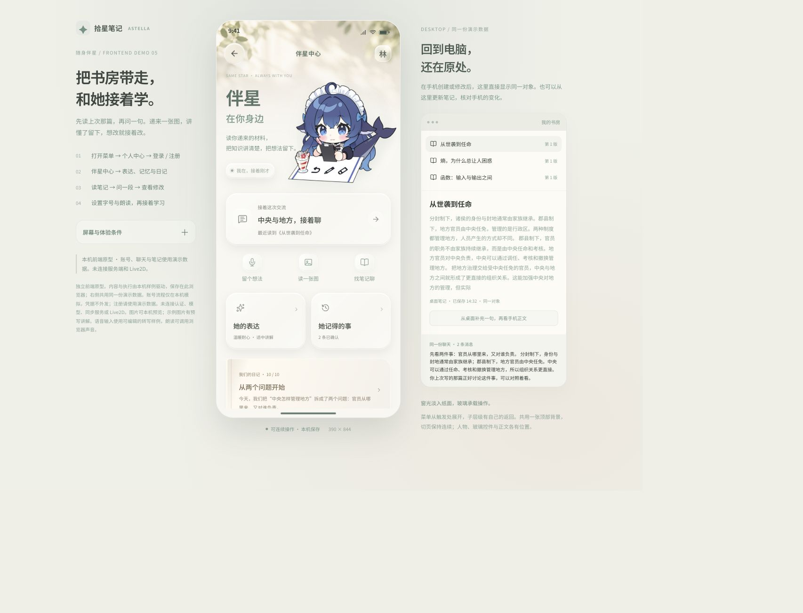
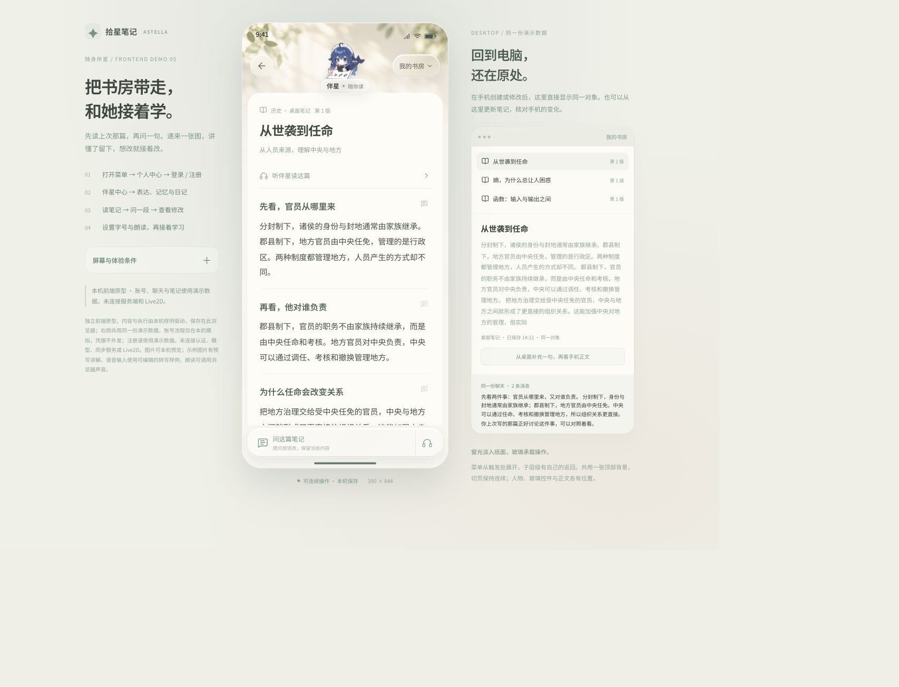
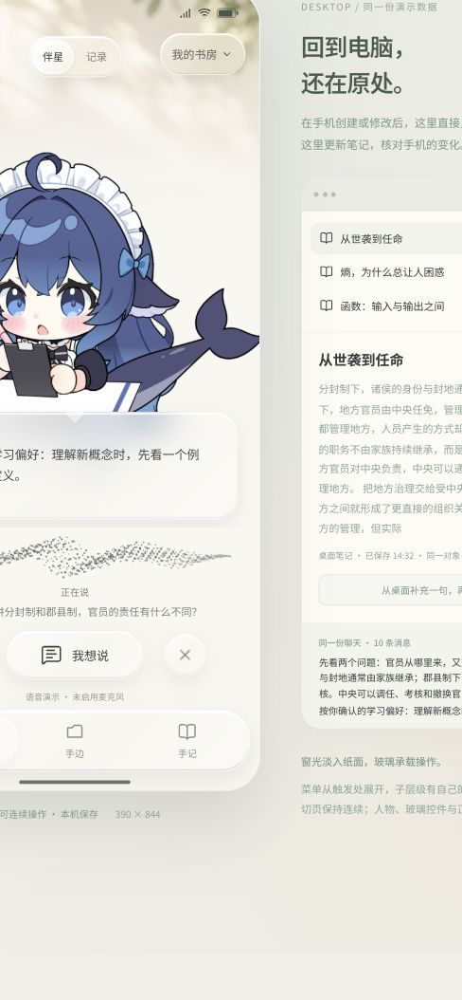

# 51 · 拾星笔记 App：随身伴星与便携书房

**2026-10-14 用户决定与原生实现补充（优先于下列历史状态）：**手机端拆为 iOS SwiftUI 与 Android Kotlin/Jetpack Compose 两个独立原生 App，旧 React 客户端不再使用且生产源已移除。双端使用相同业务语义、页面名称和视觉层级；iOS 原生层级与动效作为共同标尺，Android 通过原生控件实现。用户补充配色采用克制中性色与单一系统蓝，并适配浅色／深色外观；不使用装饰性多色渐变或撞色。一级页为“对话／手边／手记”，账户由页头进入。当前代码与未迁移能力见 [`apps/mobile-client/README.md`](../../../apps/mobile-client/README.md)、[设计规范](../../../apps/mobile-client/DESIGN_SPEC.md)。已经接入邮箱登录、共享 inbox/消息、伴星 WebSocket、图片上传、MiMo 整段转写、手记搜索与只读详情、活动 run。工程构建和设备视觉检查状态见 README；真机动效与权限仍待验收。本文中“React 浏览器客户端”“尚无原生客户端”等陈述仅代表相应日期基线。

日期：2026-10-10。本文交付产品定位、能力范围、页面与交互、数据互通要求及验收方案；本次未实现移动客户端。同日走查收窄首版范围；用户随后要求落实全部复核建议，并完成连贯的前端 Demo。以下已纳入这次修订，小程序宿主押后。Demo 为本机演示数据，不能证明移动客户端或真实共享链路已经实现。

**2026-10-12 真实实施与重设计补充：** `apps/mobile-client/src` 已出现独立 React 浏览器工程，接身份、共用伴星 inbox/事件与笔记 API；它不再只是 `prototype/`，但尚不是原生 App，语音输入与播放仍未接入。用户要求重新设计实施效果，并提出手机服务端 ASR/TTS、ASR 独立容器、两端共用伴星 WebSocket、桌面保留本机 ASR。真实交流页已重做为伴星／记录切换，接口与迁移建议见 [55](55-mobile-redesign-and-companion-realtime-2026-10-12.md)。本文下列“移动路径未验证”“只有原型”按当时范围理解；WS/ASR 尚未实施，不能以新示意抵销真机验证。

**2026-10-12 手机图片输入补充：** React 手机客户端现已支持相机／相册选图、真实 `POST /uploads/companion-images` 上传、图片与文字同回合发送，并在聊天历史中展示图片；私有图片读取通过带登录态的请求完成。文件只在用户发送时上传，服务端拒绝、超限与重试均保留草稿或待发图片。此为浏览器客户端闭环，尚未在原生真机验证相机权限、系统选图器与网络上传；移动语音、文件解析及伴星 WebSocket 仍未接入。验证范围见[手机图片输入记录](../../testing/mobile-image-intake-2026-10-12.md)。

**2026-10-11 工程审计（先读这条再看正文）：** 对前端原型做了一次独立工程审计，结论记录在[手机端前端原型工程审计](../../testing/mobile-companion-prototype-audit-2026-10-11.md)，桌面端身份基线在[桌面端身份基线](../../testing/mobile-companion-desktop-identity-baseline-2026-10-11.md)。三条要点影响本文的读法：

1. **§14.1 的两条验收声明与实际不符**（字体 150% 与 44px 热区、键盘态看到上一条回复），详见 §14.1 表后的更正。§14 其余条目同样只由浏览器载体验证，其"已通过"结论需按同一标准重新分级。
2. **前端原型不能作为移动客户端的工程起点**：它硬依赖评审实验台 DOM，脱离实验台连构造器都无法执行；与桌面**零共享设计 token、零共享组件、零共享数据契约**；业务侧没有任何模型调用。
3. **§4 的界面描述是原型说明，不是产品规格**；其中来自 Demo 的实现细节（口型参数、粒子点数上限、动效时序）只在原型范围内有效。

**审计提出的三件事项见 §19**。用户本轮已确认手机 Demo 保留角色优先，并授权继续修改样式；宿主与合规前置、差异点在首版的可感知性仍未裁决。允许按 §19.4 继续原型视觉探索，不扩写正式移动客户端规格。

## 0. 已确认的产品决定

用户已经明确：

1. App 以伴星为中心，界面精简，与桌面端共用同一套业务数据、能力与语义。
2. 伴星承担产品中的操作，包括新增笔记、读取用户递来的文件与图片、修改笔记与讲解知识。
3. 移动端与桌面端读取同一账号与空间的业务数据和伴星聊天，手机可以随时、方便地看和学。
4. 移动端不是桌面的只读影子：捕捉与写入要在手机上真实完成，不依赖桌面进程。
5. 预览与讲解是重要呈现方式；产品结构可以按移动情境重新设计。
6. 视觉参考用户提供的 Muse 玻璃面板与伴星居中布局，保留项目的色彩与身份，以实际可实现的组件构图。

**2026-10-10 设计走查后的改判（用户确认）：**

7. 小程序本轮不做。宿主渲染能力与分发资质都未核对，跨端框架也尚未选定，因此先按 App 与桌面两端设计共用；上文“两端共用一套 UI 与逻辑代码”中的两端指 App 与桌面。
8. 首版只承诺两条闭环（§2.1）：捕捉与成笔记／改笔记。原 §2.1 列出的十一项能力不再全部作为 P0。
9. 跨端实时从“同一轮流式回复”降级为“同一份数据可读”：手机打开后能看到桌面已持久化的消息、进展与成果，新到达内容以轻量提示接续；同轮流式与多端并发回合进入第二批。
10. 用户输入录音用于转写，不持久保存在服务端；现行桌面走本机 SenseVoice，不调用服务端转写。移动端识别路径尚待宿主验证；若复用服务端转写，将经过 API 与 ASR provider。迁移 0088 的约束针对用户录音资产，不是对伴星生成朗读的同一约束。伴星当时生成的 MP3 在桌面按账号本机缓存；首版不做跨端重听当时的声音。
11. 卖点围绕真实笔记、持久化操作、学习证据与持续伴星身份（§1、§1.3），不以未经核对的竞品能力或模型训练承诺作为依据。拍照提问、语音对话、传文件解读、跨设备继续同一会话属于基本要求，不再作为主打价值陈述。

12. 三个入口在一级页面保留：对话负责当前交流，手边负责进行中与待处理，手记负责已有内容和历史检索；详情页独立阅读，返回实际打开来源与原位置。
13. 桌面已有笔记的直接搜索、打开、阅读与就地提问是首版验收行为，不依赖精确段落接力先落地。
14. 伴星保留完整半身轮廓和名字／具体状态，使用清楚的见面与工作形态，不再随滚动缩成圆形头像。玻璃集中承载操作，长正文使用稳定纸面。
15. 前端 Demo 要用同一份本机对象与状态贯穿创建、修改、阅读、聊天、任务和桌面预览，覆盖独立的空态、同意、只读、离线、冲突与结果未知。

16. 2026-10-11 补齐登录／注册、个人中心、设置和伴星中心；用户随后否定整套视觉，所有页面一起重做。保留既有动效，不新增动效设置及无关工具。

17. 2026-10-11 最新决定：对话默认展示动态 Live2D，语音使用粒子音波与角色口型，伴星以小气泡交谈。原聊天记录样式保留，用户自由切换与选择；两种视图共用一份交流，不能另开手机会话。此前“有历史直接展示记录”的布局规则由此替换。

18. 2026-10-11 本轮修改 Demo 样式时，用户再次明确选择“保留角色优先：打开见到 Live2D，切换查看记录”。这项选择解决 §19.2 第 2 件的首屏方向；本轮继续浏览器原型视觉探索，不替代宿主与真实链路验证。

本方案按完整 Agent 能力组织产品，精简导航与专门功能页。新增与修改笔记、读取用户递来的材料属于核心交付，不能因没有完整桌面编辑器而推迟为只读版本。

以下页面布局、操作反馈与分阶段安排是本轮设计建议；具体框架与平台接入需工程验证。能力事实、权限、版本、保存和正式学习边界继续沿用现有领域合同。

## 1. 产品定位

**随身伴星：把你已经攒下的那间书房带进口袋。** 拿起手机直接读已有笔记，接着同一份交流；路上拍一页、随口说一句，想留下时整理成可继续修改的笔记。精确到段落的跨端接力与 PDF／Word 读取属于后续阶段。

用户可以让伴星找资料、看文件、读图片、解释知识、创建笔记、调整正文、准备学习内容，并接着追问。移动界面围绕当前交流和成果展开，但产品的分量不在“手机上也能问一句”——那件事任何一个通用对话应用都已经能做（§1.3）。

本方案围绕四种只有在这个产品里才成立的价值安排：

- **递出去的东西变成你自己的东西**：一张图、一份文件、一句话，落成有版本、有出处、还能继续改的笔记，而不是聊天里的一段回答。产物是 noteId 与不可变版本，回到桌面仍在原处。
- **已有内容随时可以读**：首版直接打开同一篇笔记和已持久化的聊天；本机阅读位置不因提问与返回丢失。跨端段落锚点、私有待看项与精确学习接续需要后续地基，不能用样例卡冒充。
- **交代的事真的被做掉了**：创建与修改走同一协同文档服务并返回持久化回执，只读空间和未授权动作会被权限判据挡住并且能解释原因；“我到底会不会”有作答与掌握的分表记账，讲解不算掌握。
- **数据选择可理解、可控制**：笔记默认私有，模型可选，服务端可自部署；录音不持久保存。是否外发、服务商如何留存或用于训练，需按实际服务配置和政策核对，不能由私有权限或不落库推出绝对承诺。

桌面端适合大空间阅读、编辑与多项工作；移动端适合临时发现一个问题、拍下一份材料、在短暂空闲中理解一小段，以及离开书桌后的继续学习。两者使用同一账号、空间、笔记、资料、图片、对话、任务和成果。

以伴星为中心体现在操作入口、持续身份、交流与结果关系。见面时角色突出；交流时给连续对话让位；阅读和学习时给原文与讲解让位。角色始终可找到，不能为了始终显示大形象而把聊天和正文挤成小窗口。

“伴星操作一切”是产品内的统一操作入口：实际能力通过共享目录与领域服务接入，依用户意图、权限和真实可用状态执行。普通问答不自动保存笔记；讲解不自动算作掌握；学习卡和拓展候选仍按领域规则审核。

### 1.1 典型使用情境

| 用户说／做 | 伴星应完成 | 最终看见什么 |
| --- | --- | --- |
| “把刚聊的知识整理成一篇笔记” | 创建独立笔记、核对保存结果 | 新笔记正文、已保存回执、打开入口 |
| 递来 PDF：“读一下这份资料” | 上传、解析、按实际覆盖范围阅读 | 文件状态、内容预览、解释与出处 |
| 发一张图片：“这道题讲一下” | 读取图片实际内容、解释 | 原图、题目识别与解题讲解 |
| “把这篇笔记第二段改成一个表格” | 定位笔记和原段、修改、确认持久化 | 已修改的正文、变更摘要与对照 |
| “用简单的例子讲讲熵” | 根据问题回答，必要时使用已开放能力 | 可读／可听的知识讲解 |
| “找上周写的那篇，补一个例子” | 搜索 → 读取 → 修改 → 核对 | 原笔记的真实更新 |
| “这份资料整理成笔记，再讲一下重点” | 处理依赖，保存笔记后基于真实结果讲解 | 同一件事的进展、新笔记与讲解 |
| 换回桌面端 | 读取同一份业务数据 | 手机刚创建和修改的内容 |
| 电脑那一轮回到一半，拿起手机 | 读取已持久化的消息与执行快照 | 相同的文字、内容块、任务与成果；逐字流式接续属第二批（§2.4） |
| 拍下一张图，问图中的一处 | 结合整图与文字位置说明解释；圈选区域进入跨端合同是第二批 | 原图、讲解与后续笔记；首版不提供圈选入口 |
| “先记住这个想法，晚上继续” | 按明确意图保存短记或待看项 | 手机和电脑都能找到、继续处理 |
| 在路上只想学一小段 | 从真实材料讲当前一处，允许主动暂停和复述 | 有来处的短讲解和可接续位置 |

### 1.2 成功体验

用户能说清要做什么或递来材料，随后知道伴星正在操作哪个对象、做到哪一步、结果是否保存，以及从哪里继续。移动端完成的操作和聊天可在桌面找到；桌面修改、消息与进展在移动端取得真实状态。

手机拿起来就能找到当前交流与手边内容；短暂使用也能完成有意义的一步；长内容可以认真阅读；回到桌面不需要复制粘贴、重讲背景或再导入材料。

精简不能牺牲成果可读性、必要的用户决定、暂停／停止、异常恢复或权限边界。

### 1.3 差异陈述的依据

拍照、语音、文件问答和跨设备聊天属于常见使用要求，不单独作为主打价值。对外陈述应说明本产品真实提供了什么，不给未经核对的其他应用下能力结论。

2026-10-11 完成竞品核对（通义千问 App、豆包 App，同日追加腾讯 ima.copilot，来源与待实测项见 §16）。原先"不给他们下结论"的保留态度可以收口为：**问、说、拍、传、生成、记忆管理、跨端同步这一层，三家都已完善且免费或低价，本方案不再把它们当卖点，也不在界面上与它们比长短。**对象层的说法要按 §16.3 收窄——**ima 已经在做笔记版本、共享库权限与 Markdown 导出**，不再能写成"竞品不做对象层"；剩下没人做的只有学习证据分级与到期复习、原件不出本机作为默认、导出动作留痕三条。

| 本产品的价值 | 可核对的依据 | 竞品核对结果 | 移动端交付边界 |
| --- | --- | --- | --- |
| 内容落成自己的笔记 | 真实对象、来源、版本与空间归属 | 千问豆包产出的是"作品／收藏"，未见可寻址的对象身份与不可变版本；**ima 已有笔记历史版本记录（2026-01-19）**，差异只剩版本差异对照与回滚深度（§16.5 待实测） | 首版可以创建、读正文和继续改 |
| 修改真正保存 | 协同文档写入、持久化回执、过期替换守卫 | 豆包工作称"全程留痕"，无回执与版本守卫定义；千问任务助理有执行记录，不核对写入版本；ima 未见写入回执与过期拒写 | 首版补对话目标解析，核对实际结果 |
| 学习证据可区分 | 候选审核、正式作答与掌握记录分别处理 | 三家均无掌握度分级；千问有错题本与重练，豆包爱学有批改与错题收录，ima 的"学业助手路线"只是合作文案里的说法，界面未见证据；都不区分"看过／练过／独立用过" | 讲解与浏览不自动宣称掌握 |
| 记忆可纠正、有来源、按空间隔离 | 每条记忆带来源与启用状态，可修正和撤回 | **修正原表述**：豆包记忆支持逐条查看、左滑删除与一键清空，"不能管理记忆"是错的。差异只剩"带来源、按空间隔离、纠正会记进事实"；ima 的记忆能力仅自媒体提及，待实测 | 沿用同一身份，不另建手机记忆 |
| 持续存在的伴星 | 已允许的身份、人格、记忆与日记机制 | 千问豆包消费端自建智能体已于 2026-07-15 全量下线（拟人化新规），该位置暂时空出；ima 无角色形态，且其"智能工作台／知识助手"呈现正落在办法豁免一侧（§15、§17） | 按实际接入范围连续，不承诺未落地能力 |
| 数据选择透明 | 默认私有、模型配置、允许的外发和自部署 | 千问承诺知识库内容非单独授权不用于训练；豆包默认可能用于训练、可关闭；两家用户都在智能体下线时遇到"数据带不走"；ima 是云端知识库，训练用途原文未读（§16.5） | **不将"不存录音"宣传成"不经过服务商"或"绝不训练"。导出已于 2026-10-11 通到界面（批量 Markdown 含图片资产、整库 JSON 存档含版本与证据与复习计划、导出动作与审计同事务）；可对外说的是"能带走"，仍不能说的是绝对的训练豁免** |

## 2. 能力范围与首批交付

### 2.1 首版只承诺两条闭环

**闭环 A · 捕捉**：拍照或选图、开口说一句 → 伴星读取实际内容并给出出处 → 讲解可读可打断 → 桌面看见同一份材料与这一轮交流。递文件走同一条闭环，但要等服务端解析链路（§13 阶段 4），首版的捕捉只承诺图片与语音。

**闭环 B · 成与改**：把刚聊的整理成笔记 → 返回真实 noteId 与保存回执 → 再说“把第二段改成表格”→ 定位原段与版本、写入、返回变更摘要与前后对照。

两条闭环合起来覆盖 §14 的主验收旅程，并且都不依赖桌面进程正在运行。

| 环节 | 首版要求 | 现状与缺口 |
| --- | --- | --- |
| 图片捕捉与读图 | 相册／拍照 → 真实图片资产 → 读图 → 解释对应原图 | 服务端图片资产与读图工具已有，移动宿主为新增 |
| 语音随手记 | 说话 → 转写 → 忠实短记 → 可再让伴星整理 | 桌面本机 ASR 与服务端转写接口分别存在；移动宿主路径待验证，短记要走真实创建，不得虚构补写 |
| 新增笔记 | 明确要求即创建，返回同一对象与正文 | 创建工具已有真实身份与回执 |
| 修改笔记 | 从对话里搜出的目标也能改，不依赖桌面当前页面 | 现有目标授权与版本绑定要求冻结页面上下文；补服务端可核对的目标引用，保留协同写入守卫 |
| 讲解与打断 | 文字先可读，声音可暂停、重听、打断后提问 | 桌面已有；移动端按同一语义接入 |
| 跨端接续 | 同一份数据可读，新到达内容轻量提示，不抢阅读与焦点 | 消息与执行快照已持久化；移动端订阅为新增，同轮流式进入第二批 |
| 文件捕捉（后续） | 选文件 → 上传 → 服务端解析 → 按实际覆盖范围读取 | 已有文本／Markdown 的私有上传与解析底座；PDF／Word 二进制解析和聊天附件关联待补（§13 阶段 4） |

**首版还必须能直接搜索、打开和阅读桌面已有笔记，并在原文旁提问。** 这属于两条闭环的共用入口与便携阅读验收，不是新增的跨端段落接力能力。知识追问与任务成果继续沿同一对象展开。

当前输入合同不允许语音转写与图片同轮。首版先保证图片加文字、独立语音随手记；拍图后同轮开口问须先扩展共享合同，不默默丢弃图片或语音来源。

新增笔记不要求先有一篇旧笔记；修改笔记不要求用户先打开完整编辑器。对象唯一且要求明确时，伴星直接执行。目标不明确才提供简短的对象选择。

### 2.2 其余能力：接入路径已定，不承诺时间

速看、思维导图、互动演示、知识拓展、学习卡、复习相关读取、日记、念想、人格／记忆及偏好等，继续复用全项目 Agent 与实际能力目录。移动端不以固定页面白名单裁掉可用能力。

需要用户审核、正式作答或选择的领域，打开相应的精简纸页：候选学习卡逐张决定，拓展笔记逐篇收下，练习由用户本人作答。伴星可组织流程、解释和执行已授权动作，不能把自己的答案写成用户的正式学习证据。

每项能力接入要同时具备请求、对象、真实执行、必要决定、成果阅读和失败恢复。已有领域 API 尚未成为 Agent 工具时补齐共享能力合同；不能仅显示聊天建议或宣称已完成。

### 2.3 精简界面的方法

首页不陈列完整来源库、笔记编辑器、学习卡后台、星图和设置菜单。用户通过伴星表达目标，通过内容纸页阅读和核对结果，通过必要的小控件做选择。

首批完整闭环为“读已有笔记／递图片／语音短记 → 讲解 → 明确要求新增 → 修改 → 桌面读取”。PDF／Word 不进入首版主画面承诺。其他能力沿同一产品结构逐步接入，不另建另一套交互与数据。

公开分享、后台持续播放、整库离线同步等独立体验另行设计，不作为核心操作的前置条件。适合手机的功能先围绕拍照、声音和接续组织，不增加另一套独立知识库。

### 2.4 首版明确不做

以下各项不在首版承诺内，写清楚是为了让“精简”变成可核对的边界，而不是靠模糊措辞蒙过去：

- 小程序宿主与“两端共用外壳”的验证；App 先行。
- 同一轮回复的逐字流式跨端呈现，以及两端同时发问的并发回合。
- 在手机回听桌面当时生成的朗读音频（首版不补跨端历史朗读资产，§9.4）。
- 基于版本的局部撤回。首版只提供前后对照与“读取最新版后重新调整”。
- 锁屏播放、后台常驻、定时提醒与主动推送。
- 公开分享、整库离线同步。
- 拍照圈问的区域引用（首版做到“拍整图并解释”，圈选只在本机标注，不进入跨端合同）。

任何一项要提前，先补 §12 对应的链路，再回来改本节与 §14 的分级。

## 3. 信息架构

| 一级入口 | 负责什么 | 不放什么 |
| --- | --- | --- |
| 对话 | 当前连续交流、当前对象引用、本轮进展和交付 | 重复的电脑摘要、多个欢迎区、全部后台任务 |
| 手边 | 正在执行、待核对、失败恢复与本机最近打开 | 完整笔记库、所有历史交流 |
| 手记 | 有权限阅读的笔记与图片、旧对话、搜索与成果来处 | 第二份进行中任务列表 |

三个入口只在一级页面常驻。笔记、图片与修改对照是详情页，收起完整一级导航，以阅读和当前内容的提问／播放为重心。打开内容时记录来源页面、对象、列表或对话位置；返回逐层恢复实际来源。切入修改对照再回正文仍是同一篇笔记。

伴星承担创建、修改、解释等操作；用户仍可以直接搜索和打开自己的内容。查找与阅读不要求先问一句话。

默认进入伴星场景，仅展示当前短句与角色状态；可切到记录阅读既有交流，保留一条可收起的对象引用。两种视图保持同一交流、草稿和执行，按账号记住选择，不额外叠“接着学”和“刚才在电脑上”摘要。切纸页不取消已提交操作，不清草稿；旧任务完成不抢新对象、阅读、焦点或声道。

## 4. 页面、角色与材质

本轮交付为连贯的真实 HTML/CSS/JS 前端 Demo，入口与验证记录见 [Demo 说明](assets/51-mobile-companion/README.md)。手机与桌面预览共用本机演示 Store；不是正式服务端或真实跨设备同步。

**本节的性质（2026-10-11 更正）**：以下是**原型的界面说明，不是产品规格**。原型硬依赖评审实验台 DOM（脱离实验台无法启动）、业务侧零模型调用、与桌面零共享 token 与组件，因此本节任何几何、时序与参数都不构成对正式移动客户端的约束，也不构成 §10「共用组件」已可行的证据。审计结论见[工程审计](../../testing/mobile-companion-prototype-audit-2026-10-11.md)；身份判断见[桌面基线](../../testing/mobile-companion-desktop-identity-baseline-2026-10-11.md)与 §19。

46–49 号记录 Demo 06 的默认 Live2D、粒子语音、保留记录和小屏键盘；37–45 号记录此前窗光底图、无色玻璃与账号页面，其中 41 号为居中伴星的新登录页。15–19 号保留 Demo 04 动效证据；已存在的 21–35 号记录被用户否定的旧账号／蓝紫视觉，均不作为现行视觉依据。

### 4.1 对话与伴星

默认展示大幅动态 Live2D，完整历史不铺在模型后面；短气泡只留当前话语，声音播报按短句更新气泡与口型，完整回复通过“记录”阅读。顶部“伴星／记录”与设置中的打开方式共用账号偏好；切换只改显示，不新建交流、不复制消息、不丢草稿。普通问答、语音聊天与读图不自动创建笔记，明确要求新增或修改才执行保存。

伴星使用完整半身轮廓，名字和实际状态就近可见。点击进入伴星中心，完整人物与接续交流有独立空间；空态可展开，连续交流用工作形态，阅读与键盘时保持较小人物；不随滚动连续压缩整套几何，也不放大裁切成圆形头像。角色可点开，空闲、读取、整理、修改和朗读按当前事实表达，不常驻“正在做事”。

人物、顶部控制、正文和底部操作分别留有正常布局空间。环境只作轻微底色和光感，没有常驻风景栏或穿过长正文的海平线。键盘展开时优先保证正在回复的文字可见，大字与小屏同样检查。

### 4.1a 粒子语音与真实模型（2026-10-11 最新修订）

语音反馈用一条无色粒子音波，监听、思考、播放和暂停都有文字状态。用户可以“说好了”、暂停／继续、“我想说”、结束或改用文字；打断立刻停止旧播报，取消后的迟到回调不能重开声音。结束不提交未说完内容，未发文字保留为草稿；已提交任务仍在同一交流完成。回到前台不自动播放或开麦。

Demo 06 使用已有批准的本机 Cubism 资源和真实动态模型，口型写入 `ParamMouthOpenY`；独立画布不跟随页面副本重建，隐藏、Off 和减少动态时停止渲染。粒子每帧至多 900 点，隐藏／暂停停止动画。当前输入是明确标注的转写样例，不采集麦克风；声音使用浏览器本机中文朗读，口型按实际播报起止、字词边界和时序估计，未取得 PCM 振幅。正式移动实时 ASR／TTS、真实音量驱动、原生音频中断与真机性能仍待接入。

详情见 [语音场景复核](../../../apps/mobile-client/prototype/mobile-companion-voice-scene-review-2026-10-11.md)。

### 4.2 玻璃与纸面

玻璃集中在角色名字／状态、输入面板、一级导航与短操作面板。按用户最新决定撤掉蓝紫色及玻璃染色，材质仅使用白色透明反光、亮边、内侧高光、背景模糊与中性阴影；自然底图透过面板本身的颜色不算玻璃染色。暖白纸面承载笔记与对照，长回复不逐段套玻璃。顶部共用一张窗光背景图，用遮罩淡入暖白底，不预留风景栏；当前页、退出副本和阅读滚动容器不铺另一块实底，避免切页顶部与底栏的横向断层。

浏览器已有实际 CSS 效果；移动宿主须验证合成开销，关闭模糊后仍保持层级与可读。动效服务进出、按压与对象关系，快速反向切换和关闭／减少动态不残留动画。保存状态使用用户能理解的文字，不把 noteId 等验收术语放在产品界面。

### 4.2a 动效来源与操作层级（2026-10-11 修订）

用户要求 Telegram 式连续感和规范的 App 操作。本次以实际 HTML/CSS/JS 重做，动作表达来源与进退：

| 操作 | 呈现与返回 |
| --- | --- |
| 菜单／书房／递材料 | 从所点控件的实际位置展开，按可用空间避让；关闭收回来源 |
| AI 说明、选择已有笔记 | 从所选行接续到面板；返回只退一层，恢复父层位置和触发行；关闭整组回到底页 |
| 伴星中心、个人中心、设置与子页 | 独立内容页，复用现有页面进退；逐层返回真实来源，账户切换清理旧展示 |
| 打开笔记／图片／修改对照 | 详情推入，返回退出并露出原来源；保留实际对象、阅读位置和段落选择 |
| 一级分区、内容类型、修改前后 | 选中玻璃垫连续移动，内容立即切换；一级分区保留各自位置，输入框只在对话 |
| 左沿右滑、拖动面板标题 | 跟随手指，距离不足／取消则回弹；满足返回条件接回上一层 |
| 发送与到达 | 消息就地递入，发送后回到输入；状态更新保留输入节点、光标及选区，不重建整屏 |

功能与焦点不等待动效。连续点击、反向返回、关闭中再打开接续当前几何；退出副本只有视觉作用，不参与定位、滚动或操作。Off 与系统减少动态直接就位并清理退出层，模糊不可用时提供实底。真实浏览器已走查；这些证据不能代表原生系统返回、Live2D 或真机性能验收。实现与检查见 [动效复核](../../../apps/mobile-client/prototype/mobile-companion-motion-review-2026-10-11.md)。

### 4.3 递材料与引用

首版“＋”提供相册、可用宿主的拍照及已有笔记引用。PDF／Word 暂不提供可执行入口。选择图片只是准备草稿，发送才把资产绑定到这一轮，不自动创建笔记。当前合同只支持单图加文字；独立语音转写不携带图片块。

已有笔记按当前空间搜索与选择；对象唯一时可由伴星直接定位。引用绑定对象、版本与实际原文范围。切空间后草稿、图片和引用留在原空间，不静默带到新空间；恢复后可继续。

### 4.4 进展与交付

本轮进展靠当前消息就近呈现，持续任务在手边有唯一汇总。正文与执行分别更新，只有实际操作产生经过。未知生成阶段不用伪造百分比；上传有总量时可用传输进度。

成果展示实际对象、简短改动／讲解和保存回执。完整笔记可直接打开，修改可看前后对照，图片可看原图。已保存成果不因回复失败被说成全失败；结果未知先核对，不能重新写一遍。

### 4.5 阅读、就地提问与修改对照

详情页给正文完整空间。下沿默认是一条“问这篇／问这一段”与播放操作，需要输入才展开提问面板。面板带当前笔记、版本和实际选中段落，原文保留在后面；提问与收起不跳走，不丢阅读位置。

新旧正文、表格、图像和宽内容按同一内容语义阅读。对照显示真实改前与改后，并说明更新的是原对象。首版提供读取最新版后重新调整，不提供未接通的版本撤回按钮。

“先给我看看怎么改”只准备草稿；“把这段改成表格”且目标明确时直接执行。冲突保留拟改要求与最新版，不整篇覆盖另一端改动。自己本轮写入后，当前引用更新到已保存版本，历史提问仍保留原来的依据。

### 4.6 手记、手边与设置

手记可直接检索桌面已有笔记、已递来的图片与旧对话；列表展示真实内容和当前版本。打开旧对话后接同一份交流，不复制成手机会话。进行中任务不在手记再列一份。

手边按状态提供停止、继续、重试、核对保存或读取最新版后调整。完成项收成简短结果，完整过程仍在所属对话中。本机最近打开只表达本机事实，不假装跨端段落接力已经存在。

账号、空间、账号级 AI 同意、阅读字号和朗读速度有明确入口。用户本轮要求不调整动效，不在 App 设置中增加动效调节；评审工作台仍可检查既有 Off 与系统减少动态。浏览与输入草稿可先使用；未同意时发送受限，说明后保留草稿，明确同意并发送才执行。

### 4.6a 账号与伴星中心（2026-10-11）

登录改为居中的完整伴星、欢迎语与一块无色玻璃表单；邮箱与密码以细分隔组织，登录是唯一主操作，创建账号与示例体验为次要入口。注册填写称呼、邮箱、密码与确认密码，使用独立透明输入框，选填邀请码默认收起。无邀请建立个人书房，有邀请再进入授权的共读空间。无账号时不展示私有聊天与桌面预览；退出暂停本机执行、停止朗读并清理展示，再次进入恢复所属账号草稿和数据。密码显示、字段校验、重复邮箱、离线反馈均就地呈现。现役接口尚无自助找回密码链路，原型不放空入口。

个人中心展示称呼、头像、邮箱及伴星入口，可编辑头像和称呼、切换学习空间、打开设置和退出。字号应用到对话与笔记正文，朗读速度应用于下一次播放；AI 使用沿用现有说明与撤回流程。

伴星中心直接进入当前交流；留想法、读图和找笔记分别接回现有捕捉、附件和内容路径，避免另起一套聊天。表达设定提供名字、说话风格、讲解分量及预览；已有记忆可修正或暂停使用，来源可以回看；日记按空间读取并回到当时笔记或交流。一般习惯跟随账号，具体材料与经历留在发生的空间。中心本身不把每次浏览或讲解计作掌握。

当前 Demo 的账号、名字、偏好与记忆均为本机模拟：示例账号提供既有记忆／日记，新注册账号从空书房开始；不自动编造新记忆或日记。注册凭据在本机加盐散列，不能替代服务端认证与安全存储。真实身份／偏好／记忆需对接现役服务，不能把原型视为持续 Agent 验收。

### 4.7 手机情境与阶段

| 能力 | 首版 | 后续依赖 |
| --- | --- | --- |
| 随时读自己的书房 | 搜索、打开、阅读和就地问 | 精确段落接力与私有待看项 |
| 拍照问一处 | 整图加文字，实际读图后解释 | 区域引用、同轮图加语音合同 |
| 语音随手记 | 忠实转写，明确保存成短记 | 更完整的连续语音体验 |
| 听一段再问 | 前台播放、暂停和打断 | 与讲解可靠绑定的完整图文跟随 |
| 文件阅读 | 首版暂不承诺 PDF／Word | 复用上传底座，补格式解析、定位和覆盖 |

### 4.8 分别呈现的使用状态

| 状态 | 呈现与恢复 |
| --- | --- |
| 空书房 | 角色与真实引导，没有伪造已有内容；普通交流不自动保存 |
| 未同意 AI | 可读书房、可留草稿，发送前说明账号级同意；拒绝后草稿不丢 |
| 只读空间 | 可以读与问知识，创建和修改明确受限，不与离线混称 |
| 离线 | 已取得且权限有效的内容可读，未发送内容保留；恢复后由用户继续 |
| 保存结果未知 | 保留同一次要求与提交身份，先查回执，不再创建或写一遍 |
| 版本冲突 | 显示最新版已变化，保留要求，明确按新版重新调整 |

失权属于权限变化，受限旧预览立即停止展示；不能因本地缓存继续访问。

## 5. 上传文件与读图片的完整路径

### 5.1 文件：选择 → 上传 → 解析 → 读取 → 操作

1. 用户递来文件并提出要求，发送后出现与该文件绑定的上传状态。
2. 服务端接收并登记共享资产，返回真实身份；上传成功只代表文件已接收。
3. 解析任务提取正文、图片与可靠的页／段落定位，分别表达已解析、部分解析或失败。
4. 伴星按当前要求读取实际可用内容，长文件按任务需要续读，并保留覆盖信息。
5. 回答、讲解、生成笔记或修改已有笔记，均继续使用这份材料的真实引用。
6. 交付纸能打开原文件／解析预览及成果；桌面手记与对应材料入口能找到同一资产。

PDF／Word 的二进制格式读取落在 §13 阶段 4；文本／Markdown 已有私有对象上传与 worker 解析底座，需要复用并补聊天附件关联；在它落地前，闭环 A 的捕捉只承诺图片与语音。目标格式为文本、Markdown、代码、PDF 与 Word（.docx），具体格式、大小、加密文件和页数限制来自统一合同。旧格式和无法解析的文件明确说明原因与下一步，不静默丢弃或截断。

扫描 PDF、图片页与文字提取失败的页面要识别出来，再按可用图像理解能力处理并标明范围。未读完时不能声称“全文已读”；跨页表格与图文顺序需要样本验证。

### 5.2 图片：实际读图后再讲解

图片上传后使用现役资产身份和读图能力，图片、解释与后续笔记指向同一对象。不能只根据文件名或用户问题猜图里写了什么。

识别不清楚的区域明确指出，可让用户补图、换清晰原图或指定局部。图中的题目、公式、图表与截图可以继续解释；用户明确要求时再整理为笔记或插入已有笔记。

首版使用整图与文字说明所问位置，不提供圈选入口。后续圈选不改变材料身份；区域引用进入跨端合同后（第二批），要同时保留原图身份与区域位置；圈选和放大只改变所指范围，用户能取消或调整。后续“旁边这条曲线”需回到实际原图核对，不能只记住一张无来处的裁切图。

### 5.3 上传材料与正式资料区分

会话附件成为当前账号与空间内可核对的资产，可在桌面查看同一消息与附件；它不因上传就变成公开资料或新笔记。

“收录为资料”“根据这份文件创建笔记”等明确操作才产生相应来源／笔记业务对象，并保留附件、解析内容和成果之间的关系。会话文件读取与空间资料创建分别沿用实际权限；只读空间不能借上传绕过资料和笔记写入规则。

移除未发附件不会删除用户已有资料。重试沿同一提交身份核对资产、解析任务和后续写入，避免形成多份重复笔记。

## 6. 新增笔记与修改笔记

### 6.1 新增笔记

用户说“把刚聊的整理成一篇笔记”，伴星利用当前讨论和真实材料生成独立正文，按现有规则检索、读取相关笔记并附真实关联。没有相关内容时可以保存独立笔记。

新笔记保存到当前有权限的空间，默认本人可见。服务端确认后，交付纸直接提供新笔记正文和入口。无需用户进入笔记库按“新建”，也不要求为了保存再重复说一次同意。

任务重试返回同一已创建对象；后续“补个例子”修改这篇真实新笔记，不能每次创建一篇副本。用户只要求回复里的总结时，继续作为对话交付。

### 6.2 修改笔记

目标可以来自当前纸页、用户选择的内容、上一轮新笔记，或本轮实际搜索／读取的唯一笔记。目标和位置不用依赖某台桌面当前打开的页面。

读取当前版本 → 确定原段与用户范围 → 生成改动 → 核对原文和版本 → 通过已有协同文档服务写入 → 确认持久化 → 更新正文、搜索和交付纸。

局部修改绑定可靠段落和原文；全文格式整理依据整篇实际内容；追加不要求手机提供桌面光标。插入光标等位置存在时可沿用，但不能凭模型猜测坐标。

### 6.3 冲突与对照（局部撤回在第二批）

桌面同时改了同一段时，过期替换停止，移动端保留拟改内容和最新原文，用户可继续要求合并。不得用整篇覆盖把另一端改动抹掉。

修改结果可以查看前后对照。**基于版本的局部撤回不在首版**（§2.4）：它要先检查目标段之后是否有新改动，再按补丁合同恢复相应内容并返回回执，是一项新的服务端能力，不是一个按钮。首版只提供“前后对照”与“读取最新版后重新调整”两个动作；在它落地前界面上不出现“撤回”字样，交互稿里那颗按钮标注为样例。

“停止”只影响尚未完成的工作；已落盘的新增或修改仍保留，实际状态分别说明。写入结果未知时先查询和核对，不能自动再做一次。

## 7. 知识讲解、自由交流与复合目标

无材料的问题可以直接讲知识；有引用时按实际需要读取。用户可以从“讲讲这个概念”转到“写成笔记”“再改这段”，身份、交流、材料和成果连续。

讲解文字、图文与声音属于同一条回复。原句、查阅片段和联网来源按现行交付语义呈现；联网仍受账号开关与真实服务状态约束。

用户要求“读这个文件，整理成笔记，再给我讲重点”时：

- 上传与解析是阅读依赖，界面如实等待；
- 伴星读取材料后创建笔记，核对真实保存；
- 讲解使用刚保存的笔记／原材料，成果直接可打开；
- 任一步失败保留已完成部分，用户可继续剩余步骤；
- 不要求分三次发消息或切换三个功能模式。

用户“先别写了，我想问个问题”立即接当前意图；停止写入与转话题依明确要求处理。旧后台完成不能替换新回复、抢焦点或抢声道。

移动学习默认由用户选择当下需要的深度：一句话先懂、一段解释、展开完整纸页，或“我试着讲一遍”。伴星针对用户的实际复述给出具体反馈，再按明确要求继续讲、记笔记或安排已开放的学习动作。无需每次固定走“生成提纲 → 讲解 → 测验”。

声音不是把整篇正文机械播放一遍：当前讲解段落、相关图文与来处可以就近对照。用户选择边听边看时，实际语音分段能定位所讲内容；手动滚到其他部分不被持续强拉回来，提供轻量“跟着讲解”入口。

## 8. 交流、工作与语音状态

材料上传、解析、Agent 执行、本机播放、收音与纸页展示各自有状态，不能用一个“忙碌”同时锁住全部界面。

| 状态 | 用户看到什么 | 可做什么 |
| --- | --- | --- |
| 附件准备／上传 | 文件签或图片缩略图，真实状态与错误 | 移除未发项、重试失败项、保留文字 |
| 正在解析 | 该文件的解析状态，部分内容可用时明确范围 | 查看已得内容、取消未完成步骤、继续聊天 |
| 消息尚未接受 | 保留输入，显示发送中／未发出 | 核对后重试 |
| 已接受、正在执行 | 当前动作、真实进展和已有成果 | 改要求、看已有内容、明确停止 |
| 正在修改／保存 | 目标笔记和相关范围，等待真实保存 | 看其他内容、停止剩余工作 |
| 完成或部分完成 | 对象、成果、保存回执与未完成项 | 打开、追问、核对、重试剩余步骤 |
| 正文已有、声音准备中 | 文字先可读，声音入口表达等待 | 读文字、继续等、改用文字 |
| 正在朗读／暂停 | 实际播放状态与对应角色表达 | 暂停、继续、重听、我想问 |
| 正在收音 | 字幕及明确收音状态 | 说好了、暂停、结束、改用文字 |
| 结果未知／版本冲突 | 保留已有内容，不宣称失败回滚 | 查询、对照、重新定位 |
| 离线／失权 | 失败在对应位置，受限内容不继续展示 | 保留草稿、换材料、恢复后核对 |

暂停音频、停止任务和收起纸页是不同动作，名称和回执明确。收起不取消服务端已经接受的操作。

“我想问”立即停止本机旧声音与说话动作，进入新输入或收音；提交后按最新回合处理旧输出。旧内容留在手记，取消提问可主动继续原讲解。结束收音不发送未完成内容。

返回前台不自动开麦或播放旧回复。首版不依赖锁屏播放、后台常驻和推送完成操作；服务端接受的工作可以继续，重进查询真实状态。

用户输入录音用于本次转写，不持久保存。桌面现行走本机识别；移动宿主路径待验证，若选择服务端转写，需明确经过 API 与 ASR provider。伴星当时生成的朗读 MP3 是另一类音频，桌面本机缓存可原声回听；首版不补跨端历史朗读资产。手机没有当时音频时保留文字，新朗读明确是新生成，不重新生成聊天正文。

## 9. 与桌面端的数据互通

### 9.1 同一套业务数据

~~~mermaid
flowchart LR
    D["桌面端"] --> S["统一身份、API、Agent 与领域服务"]
    A["App"] --> S
    S --> B["同一空间：笔记、资料、附件、图片、任务、成果与历史"]
    B --> D
    B --> A
~~~

同一账号与空间使用同一笔记、版本、协同文档、资料、图片资产、对话、任务、成果及允许的伴星身份与记忆。移动端创建或修改直接提交现有服务端事实，不通过导入导出或另一套手机数据库再“同步回去”。

**同一份数据可读是首版要求，同轮流式是第二批。** 同一账号、同一空间的桌面端与 App 使用同一份连续聊天：相同消息身份、用户原话、伴星正文、引用、图片、工具经过、成果和实际决定。来源设备只用于识别宿主和事件归属，不另分一套“手机聊天”。首版的验收口径是：手机打开当前交流时，桌面已经持久化的内容、任务与成果完整可读，新到达的内容以轻量提示接续；把同一轮回复的逐字流式跨端呈现与两端并发回合放在第二批（§2.4），因为它们需要额外的迟到事件隔离与抢占呈现，不该占住两条主闭环的位置。

手机操作不要求桌面正在运行。文件解析和笔记写入需要能在共享服务链路独立完成；桌面上打开过的页面、光标或本机缓存不能成为移动端执行的隐藏前提。

### 9.2 哪些状态同步，哪些属于本机

| 共享事实与记录 | 本机呈现状态 |
| --- | --- |
| 笔记正文、版本、分享范围、来源与关联 | 当前展开的纸页与阅读位置 |
| 上传资产、解析状态、图片与内容引用 | 尚未发出的草稿与键盘焦点 |
| 对话、任务要求、进展、成果及实际决定 | 正在播放／收音与本机音量 |
| 持续身份、允许的一般习惯与空间经历 | 当前场景大小、性能与动效偏好 |
| 用户私有待看项及可主动接续的阅读／学习位置 | 当前是否跟随讲解、临时圈选和未发附件 |

另一端更新笔记时，按协同／版本合同更新内容与状态；原解释保留其依据，提示可以按新内容再讲。变化不自动把当前讲解切换到另一条任务。

另一端有消息落库或工作完成，所属交流、历史和成果随之更新；首版同步的是已持久化的内容，同一轮的逐字流式在第二批（§2.4）。当用户正看当前交流末尾时直接接入同一条消息；正在翻旧记录或读其他材料时给出轻量新内容提示，不抢阅读、声音和焦点。

换空间重新核对材料和权限；含引用草稿留在原空间，用户可明确只带走自己输入的文字。换账号清理旧展示、订阅、音频和待发引用。一般伴星身份可连续，具体材料与经历不能跨来源泄漏。

### 9.3 保存与重试

每次上传、解析、创建和修改都绑定稳定提交身份与真实对象。断线重试先核对是否已经接受或保存；已经创建的笔记直接返回同一对象，不能再造副本。

移动端显示“已保存”后，桌面重新查询必须取得相同对象及正文；协同场景中接入实际文档更新。桌面正在显示旧内容时明确版本状态，并有刷新／接续路径。

业务提交成功后回复失败，成果仍是成功成果；只有接收增量或动画结束都不足以显示“已保存”。

### 9.4 跨端接续的真实口径

手机打开当前交流后读取的是已持久化的消息与执行快照：文字、图片、工具经过、成果与决定完整可读，不需要手动导入或重讲背景。手机接着追问，电脑同一份记录中出现这条用户消息及回复。本轮尚未结束时的逐字流式呈现放在第二批。

断线重连先以持久消息与快照补齐，再接事件增量；同一内容不能重复追加，旧快照不能倒退当前状态。切空间后旧事件只更新其所属记录，不能污染新空间的主画面。

**并发按现有合同写，不写成两端各跑一条。** 服务端每个会话同一时刻至多一个回合在跑，后来者被拒并要求带匹配的抢占标识才能取代旧回合。移动端因此要呈现的是“另一端已经开始新的一轮”，并首版保留草稿并说明当前回合正在执行，可以先看结果稍后再发；明确接管及抢占呈现放在第二批。不能通过复制消息或静默覆盖草稿解决竞争。用户明确停止同一任务时，各端看到相同停止结果；本机麦克风和播放不会因另一端单纯查看而开启。

文字、图片与操作回执属于共享聊天。用户输入录音的“不持久化”约束与伴星朗读的本机 MP3 缓存是两件事：前者不意味着音频不经过 API 或 ASR，后者不由前者的数据库 CHECK 禁止。首版不做在手机回听桌面当时生成的声音；手机可按能力新朗读同一份文字，并明确是新朗读。

### 9.5 接着学的产品行为

“接着学”读取当前材料、可靠的段落／页位置、所指解释及用户已经做过的一步，呈现一个可主动继续的入口。可以从手机回电脑、从电脑回手机，也可以只在手机继续。

接力位置和待看项是用户私有的接续信息，与资料身份及版本绑定；不是掌握标签、正式评分或复习计划。版本变化后核对锚点，无法可靠定位时保留原片段并让用户选择最新内容。

多个设备各自的当前视口独立。共享位置作为继续的候选，不强制另一端跳页或改写它正在使用的本机阅读位置。

## 10. App 与桌面共用什么

| 共用实现 | 宿主适配 |
| --- | --- |
| 可复用的内容块、附件签、经过、交付回执与对照组件 | 顶部外壳、安全区与系统返回 |
| 草稿、材料引用、任务控制和成果打开 | 文件选择、相册、拍照和传输 |
| 操作／保存／冲突／重试状态规则 | 凭据存放、网络与生命周期 |
| 收音与播放的语义、互斥和打断 | 录音、播放、音频中断与权限 API |
| 伴星身份和表达状态 | 角色运行、资源加载、设备性能 |
| 内容块、领域决定与阅读行为 | 实际渲染容器、键盘、大图与宽内容查看 |

App 与桌面共用请求、对象身份、内容语义和操作控制；已有内容组件按依赖复用，导航与布局可各自适配。平台差异通过能力接口注入，不强行共用整个页面骨架；不能各自写一套新增笔记、重试或修改合同。服务端继续使用共享能力目录、统一 Agent、执行治理与领域事实：两端可以有不同布局，但不能有不同的保存语义、权限判据或成果身份。

小程序作为独立宿主本轮不设计。它涉及三件未核对的事：磨砂大面与角色渲染、文件与音频的宿主接口、以及 AI 问答类目的分发资质（§15）。这三件任一不成立，“两端共用一套 UI”就要降级为“共用逻辑与语义、外壳各自实现”，所以先按 App 落地，小程序等结论再议。

目前桌面 DOM、Electron IPC 和本机解析器有宿主耦合，需要按真实依赖提取或改接服务——其中 PDF／Word 解析现在整个跑在桌面渲染进程里，是移动端文件捕捉的真正前置（§12）。跨端框架不做纸面选型：先用 §13 阶段 0 的证伪样例证明角色、附件、纸页、中文输入、语音与真实接口能在候选宿主里接通，再定。

## 11. 原文、权限与领域边界

| 内容／动作 | 必须核对 | 对用户的表达 |
| --- | --- | --- |
| 文件和图片 | 实际资产、当前权限、读取覆盖与图像清晰度 | 读过哪些、哪些不可读、来处在哪里 |
| 笔记读取 | 实际正文、版本及可见性 | 原文、摘录和 AI 整理区分 |
| 笔记创建 | 当前空间写入权限、真实来源与保存结果 | 已创建对象直接打开 |
| 笔记修改 | 目标、原文、范围、版本和持久化 | 改了哪里、是否保存、冲突如何继续 |
| 学习卡与拓展 | 候选、审核与正式保存各自身份 | 待决定动作直接可见 |
| 正式练习 | 用户本人作答、真实评分与记录 | 伴星的解释不冒充用户答案 |
| 跨端接续 | 相同账号／空间、稳定任务与版本 | 继续已有工作，不重复生成 |
| 声音与动画 | 实际收音／播放／执行状态 | 表情只补充反馈，不替代回执 |

用户明确交代新增或修改，范围确定且权限允许时直接执行。只有对象歧义、超出已交代范围，或领域合同要求本人决定的动作才呈现必要选择。日常写入不增加层层批准纸页。

AI 同意、图片外发与联网开关沿用账号级规则；未授权时解释真实受限能力。上传、一般知识回答和业务写入的权限分别核对，不借“伴星能做”突破空间角色规则。

失权或删除的内容不因旧预览／旧附件继续展示。旧版本解释保留依据，无法定位时回到旧片段，不凭相似文字猜新位置。

## 12. 现状核对：已有底座与真实缺口

本轮到代码里逐条核对，结论按“已有／要新建”分列。证据路径写在这里，是为了避免下次再用文档结论代替现状。

| 事项 | 现状 | 移动端要补 |
| --- | --- | --- |
| 能力目录与统一 Agent | 已有：共享能力目录、执行治理与领域事实，工具依权限与政策过滤 | 移动宿主接同一目录，逐项覆盖成果路径 |
| 新增笔记 | 已有：真实创建、稳定身份与保存回执 | 移动请求、生成进展、新笔记直接可读、桌面同处可见 |
| 修改笔记 | 部分：协同写入与持久化已有，目标须匹配冻结 page_context，版本从其核对；不是所有操作都依赖光标 | 脱离页面上下文：从对话搜索出的目标也能定位与写入；冲突与过期替换要停 |
| 读图与图片资产 | 已有：图片上传四条路落到同一资产身份，读图工具在用 | 移动相册／拍照、清晰度与失败恢复；同轮图加语音先扩展合同 |
| 服务端文件上传与解析 | 部分已有：私有对象直传、`source_text` 完成与 worker 解析已存在；当前仅接受文本／Markdown，PDF／Word 的现有解析在桌面 | 复用对象存储、传输、权限与任务；补二进制解析、聊天附件关联、页／段定位、覆盖与部分失败 |
| 回合输入合同 | 已实现但受限：每回合 1-2 个内容块，首块必须是文字，第二块只能是用户图，语音转写携带图片块判为非法 | 多材料与“对着图片说话”需要新合同，App 与桌面共同理解；小程序宿主后续另验 |
| 消息持久化与事件流 | 已有：消息、带序号的流事件、执行快照，SSE 支持 Last-Event-ID 补发，桌面经主进程订阅 | 移动端订阅、断线恢复、切空间后的迟到事件隔离 |
| 多端并发 | 已实现为抢占：每会话同一时刻至多一个回合在跑，后来者被拒并要求带匹配的抢占标识 | 按真实合同呈现“另一端已开始新的一轮”与两个动作，不假称并发 |
| 历史原声 | 两类事实：用户录音资产约束不持久化；伴星生成的 MP3 分段另按账号存桌面本机缓存 | 不补共享原声，明确不做（§2.4） |
| 待看项／接力位置／阅读位置 | 尚未发现符合共享接续语义的表与 API；现有的每回合页面快照与引导旅程恢复标记语义不同 | 新建用户私有的接续数据、与材料及版本绑定的锚点与核对规则 |
| 版本与来处引用 | 已有：不可变版本、来源到笔记块的挂接、选区锚点 | 区域引用（第二批）、短记、接续位置沿用同一身份 |
| 用户数据导出 | **已落地（2026-10-11 晚于本行首次核对，旧"缺口"结论作废）**：设置中心提供批量 Markdown 目录（`renderer/src/components/surfaces/settings/settings-surface.tsx:685` → `window.astella.note.exportMarkdown` → `main/note-markdown-export.ts`，一篇一个 `.md`，图片按内容去重进 `assets`，回执按 `exported + failed === total` 说话）与整库 JSON 存档（`main/desktop-gateway-ns-workspace.ts:68` → `GET /export/workspace`，`api/src/modules/export/service.ts` 实导 21 个集合，含 `note_versions`、`source_segments`、证据快照与 `review_schedules`）；两条路径均与导出动作**同事务写审计**，整库导出为 owner 门 | 移动端沿用同一服务端接口；对外仍只说"能带走什么"，不引申为绝对训练豁免（§1.3） |
| 伴星的监管适用性 | **未评估**：《人工智能拟人化互动服务管理暂行办法》2026-07-15 施行，定义覆盖"模拟自然人人格特征、思维模式且能开展持续性情感互动"的服务，办法只豁免智能客服、知识问答与工作助手 | 上架前先判定伴星落在哪一类；未成年人模式、安全评估与算法备案按 §15 一并处理 |

三条不能混为一谈：不能把“服务端已经能读来源”当作“手机已经能传 PDF 并读全文”；不能把“有编辑工具”当作“任意对话目标已脱离页面约束可编辑”；不能把“消息与快照已持久化”当作“同轮流式跨端已接通”。前两条属于本方案的核心实施工作，第三条已被排到第二批。

## 13. 首版交付顺序

| 阶段 | 具体交付 | 通过条件 |
| --- | --- | --- |
| 0 · 宿主验证（先核对成本） | 候选 App 宿主里跑：玻璃大面、角色静态帧、中文输入、录音与中断、文件转入、键盘与安全区 | 出一页结论表（能／不能／代价）。任一不成立就回到 §10 重议共用程度，**不带着未证的宿主进下一阶段** |
| 1 · 闭环 A 的图片与语音分支 | 当前交流、已有笔记搜索／阅读／就地问、附件签、拍照与选图、读图、独立语音与真实短记 | 先在手机直接打开桌面已有笔记并问一段；再递图加文字解释，独立语音记想法，桌面读到同一材料与笔记 |
| 2 · 闭环 B | 从对话搜索目标并读取、修改与前后对照、保存回执、冲突不覆盖、停止与结果未知 | 一轮完成“读这篇 → 整理成笔记 → 第二段改成表格 → 桌面打开同一 noteId”，桌面进程关闭时仍可完成 |
| 3 · 接续地基 | 待看项与阅读／学习位置的表与 API、与版本绑定的锚点核对、手边与“接着学”的真实数据 | 手机留下一个位置，换到桌面主动继续；改版后能核对；没有样例数据冒充 |
| 4 · 文件捕捉 | 复用私有上传与文本解析底座，补 PDF／Word 二进制解析、资产关联、页／段定位、覆盖与部分失败 | 一份含图 PDF 在手机上传并按覆盖读取，未读部分明确说明 |
| 5 · 第二批 | 同轮流式跨端、多端并发呈现、局部撤回、区域引用、边听边看完整版、小程序宿主 | 逐项按 §2.4 重新立项，不默认继承本方案的承诺 |

阶段 0 的最小样例只用于验证，不作为另一个只读产品发布口径。阶段 1-2 是可读、可问、可写的便携首版。阶段 3 增强精确接续，阶段 4 增加 PDF／Word；未实现时不在首版画面放可执行入口或填充假位置。

每项能力同时交付可操作 UI、真实执行、成果与失败恢复。新能力加入共享目录和领域合同，再按用途复用交付纸与精简决定纸页。

## 14. 验收标准

首版只验收 P0。P1 是第二批的入口条件，不进入首版发布判断。

### 14.1 P0 · 首版必须通过

| 场景 | 通过条件 |
| --- | --- |
| 打开与空空间 | 先见伴星；能聊天、递材料和要求新增；无自动开麦或发任务；空状态有真实引导，不用样例数据填 |
| AI 同意未签或失效 | 输入与浏览可用；第一次发送前给一次同意说明与就地签署入口；拒绝后保留只读书房，不让用户撞失败 |
| 已有笔记阅读 | 直接检索桌面已有笔记，打开正文、引用一段提问、收起后保持位置，返回原来的列表或交流 |
| 图片理解 | 使用真实资产读图，解释对应原图，不根据文件名猜图 |
| 语音随手记 | 说一句话即创建忠实短记，桌面可打开同一 noteId；短内容不为凑篇幅虚构补写 |
| 新建笔记 | 明确要求即可创建；正文和保存回执可读，桌面可打开同一 noteId |
| 连续修改 | 对刚创建的笔记补写／替换，更新原对象，不重复建副本 |
| 搜索后修改 | “改上周那篇”能查找、读取和写入，不要求打开桌面编辑器、不依赖桌面当前页面 |
| 改正文回执 | 通过同一文档服务保存，正文与搜索更新，已广播不冒充已持久化 |
| 冲突与停止 | 两端改同段时不覆盖新改动；停止只影响未完成工作，已保存成果保留；结果未知先核对，不重试再写一遍 |
| 复合目标 | 读取、保存和讲解按依赖接续，一轮完成或给出真实部分结果 |
| 讲解与打断 | 暂停接续实际声音，打断立即停旧播放，旧回执不抢新回复 |
| 收起与后台 | 收起不取消服务端已接受的操作；回来可恢复；不自动收音或重播 |
| 跨端数据 | 手机写入桌面取得；桌面改动手机取得；同一版本／权限／任务事实 |
| 当前回合占用 | 当前会话有未完成回合时保留草稿、显示真实忙碌与稍后继续，不静默覆盖或复制回合；接管呈现为第二批 |
| 移动独立执行 | 桌面进程全部关闭时仍能读图、创建和修改笔记 |
| 权限与只读空间 | 账号、空间和外发规则一致；只读空间不因上传或对话绕过写入；受限动作可解释 |
| 学习事实 | 候选审核和正式作答由本人决定，预览讲解不自动算掌握 |
| 构图与键盘 | 聊天不藏在历史入口里；角色随任务让出空间；**抬起键盘后仍能看到上一条回复的一行**（⚠️ 2026-10-11 审计：默认伴星视图在 320×640 + 键盘下把回复气泡 `display:none`，见下方更正）；长回复、字体放大 150%、320px 宽下正文不被裁切且关键操作热区不小于 44px（⚠️ 2026-10-11 审计：150% 只作用于 308 处 `font-size` 中的 14 处，章节标题被封顶 120%，多处热区 30–38px，见下方更正） |
| 动效与减少动态 | 快速往返、连续输入、打断时过渡跟随最新意图；动效关闭与系统减少动态下无残留动画，焦点不等待动画 |

**2026-10-11 更正（审计发现，见[工程审计](../../testing/mobile-companion-prototype-audit-2026-10-11.md) §二）：**

- **"字体放大 150%／热区 44px"未通过。** 四个 CSS 共 308 处 `font-size`，仅 14 处引用 `var(--text-scale)`；开大字后正文生效而版本号、来源、元信息、一级导航仍为 10–12px，正文章节标题被 `min(var(--text-scale),1.2)` 封顶在 120%。热区实测低于 44px 的包括 `.dialogue-modes button` 38×36、`.scene-title button` 62×30、`.voice-side` 43×43、`.account-check` 32、`.key-row button` 36。
- **"键盘态看到上一条回复"未通过。** [scene.css:56](../../../apps/mobile-client/prototype/mobile-companion-scene.css) 在 320×640 + 键盘 + 默认伴星视图下隐藏 `.scene-speech`；而 capture 脚本在断言这一条前先要求 `mode === 'history'`，只量了记录视图，因此该断言恒绿。
- **键盘本身是模拟的**：`--keyboard` 取屏高的 32%，全仓库无 `visualViewport`；真机 iOS 键盘通常比模拟值大 30% 以上。

因此：**§14.1 在补上真机与真实链路证据前，不作为发布判断依据。** 其余由同一套载体验证的条目（图片理解、语音随手记、跨端数据、移动独立执行、真实文件解析）在原型中同样无真实执行——原型业务侧零网络调用，图片与语音为预写样例，键盘为 CSS 类切换。

### 14.2 P1 · 第二批的入口条件

文件上传与服务端解析（含扫描页与部分失败）、待看项与接续位置、同轮流式跨端、局部撤回、拍照区域引用、边听边看完整版、小程序宿主。文件与接续分别按 §13 阶段 4 与 3 接入；其余按阶段 5 单独核对，不统一写成同一阶段。

### 14.3 主验收旅程

**旅程一（闭环 A＋B）**：手机拍一页书 → 让伴星解释其中一处 → 说“整理成笔记”→ 再说“把第二段改成表格”→ 打开真实修改结果与前后对照 → 回到桌面找到同一笔记、同一材料与同一轮聊天 → 桌面改一段后手机继续问它 → 核对冲突与版本。

**旅程二（捕捉与不打扰）**：路上用语音记三条想法 → 前台边听边看完一段讲解 → 中途打断提问 → 收起界面去做别的 → 重新打开时任务状态与已有成果还在，旧声音没有抢新回复。

两条旅程都要在真机跑，不用浏览器稿替代。

**2026-10-11 状态：这条尚未满足。** 目前全部证据来自桌面浏览器（评审实验台 + 假手机框 + CSS 类模拟键盘），没有任何真机记录；[工程审计](../../testing/mobile-companion-prototype-audit-2026-10-11.md) §八列出的真机行为（原生键盘、安全区真值、移动 GPU 上的 Live2D 帧率与内存、音频中断、后台生命周期）全部未验证。

### 14.4 验收样本清单

真实教材扫描页、含公式的题目照片、低清与倾斜照片、跨页表格 PDF、部分解析失败的文件、只读空间、弱网与断线、超长笔记与超多任务列表。圈问与读图不能用手绘占位图当样本。

质量以是否完成真实操作、依据是否正确、用户是否知道保存结果为准，不用关系等级或功能按钮数量替代。

## 15. 工程与分发前提

**工程侧仍需验证**：App 首批操作系统与跨端框架（阶段 0）；Live2D 或静态取帧的性能与资源加载；平台文件、相册、拍照、分享转入、音频与中断行为；账号绑定与凭据存放；服务端文件解析与多材料合同；移动端事件订阅与迟到事件隔离；原文定位与协同冲突；接续位置与版本锚点。

**分发与合规尚未核对，且优先级高于界面**：伴星的每个核心交互（对话、识图、语音、主动提示）都是生成式能力，App 与小程序在国内上架涉及主体资质与生成式 AI、深度合成相关的备案与类目要求，海外商店另有其规则。这份方案不假设这些条件已经成立：在确认之前，App 的上架形态（自有商店分发、TestFlight 类测试通道、还是先做网页版）与小程序是否值得投入都属于待拍板事项。§13 阶段 0 只解决技术宿主，不解决资质。

**2026-10-11 补充的具体条款依据**：五部门《人工智能拟人化互动服务管理暂行办法》2026-04-10 公布、2026-07-15 施行，覆盖"模拟自然人人格特征、思维模式和沟通风格且能开展持续性情感互动"的服务；明确**智能客服、知识问答与工作助手不适用**——伴星能否归入豁免，取决于它被呈现为"学习工具里的角色"还是"持续性情感陪伴"，这条要在写对外文案和界面话术之前定下来。办法另要求禁止过度迎合与诱导情感依赖、不得向未成年人提供虚拟伴侣、不满 14 周岁须监护人同意、提供未成年人模式（时长限制、现实提醒、监护人管控充值消费）、新增安全评估与算法备案，并对训练数据设六项义务。已经发生的行业事实：通义千问与豆包的**消费端自建智能体均在 2026-07-10 至 07-15 全量下线**，且未提供数据留存或迁移通道，用户对"数百小时调教无法迁移"的投诉是本产品应当正面回答的对比点（见 §16）。

这些是实施需要解决的接入和质量问题。首版围绕真实笔记、已有内容便携阅读、实际保存与透明的数据选择交付；精确段落接续和服务商训练政策按各自证据核对，不能提前写成已经具备的承诺。

## 16. 竞品核对：通义千问 App、豆包 App、腾讯 ima.copilot（2026-10-11）

**方法与边界**：本节由独立检索汇总（千问能力、豆包能力、市场与监管），同日追加一路腾讯 ima 核对，信息截至 2026-10-11。分级标注：**官方**＝厂商应用商店描述、官网、隐私政策、官方通稿或官方社区/技术百科；**媒体**＝新浪、证券时报、36氪、澎湃等转述第三方监测（QuestMobile／IDC／洛图）；**用户**＝应用商店评论、投诉平台、下载站版本记录、社区；**待实测**＝检索到互相矛盾或只有内容农场来源的说法，一律不下结论。中文检索结果里大量"教程"页（php.cn、百度知道、部分自媒体、AI 目录站）会编造界面路径与参数，本节对这类来源只取"多方一致的入口存在性"，不取路径与数值。**我方一列按代码核对，不取文档结论。**

**为什么 ima 必须单列**：千问与豆包的单位是对话，ima 的单位是知识库——它把"笔记 + 个人库 + 共享库 + 溯源问答"当成主产品，**这是第一个打在对象层上的对手**。本节 §16.3 的结论与 §17 的收口前提因此改写过一次；引用本节时不要用"对象层竞品不做"这个旧口径。

### 16.1 规模、定价与投入

| 事实 | 数值 | 级别与来源 |
| --- | --- | --- |
| 中国 AI 原生 App 月活总盘（2026-06） | 4.99 亿，同比 +85.4% | 媒体（QuestMobile，证券时报 2026-08-11） |
| 豆包月活 | 3.823 亿（+172.1%）；7 月 DAU 1.68 亿且**环比零增长**，为 2025-08 以来首次停涨 | 媒体（2026-08-05；华尔街见闻 2026-09-09） |
| 千问月活 | 1.67 亿（2026-06）；2026-09-22 官方称服务 3 亿用户 | 媒体／官方（2026-09-22；国际金融报 2026-09-28） |
| 千问留存回落 | 月活由 2 月 3.22 亿回落至 3 月 1.66 亿，人均时长 9.62→6.71 分钟；红包驱动 7 日留存 <20% | 媒体（新浪财经 2026-09-17；网易 2026-07-11） |
| 豆包变现 | 日活超 2 亿但日收入不足百万元（主要为电商佣金）；有效付费会员约 90 万；通用对话团队（约 50 人）缩减一半 | 媒体（引《晚点 LatePost》2026-09-17；国海调研 2026-09-10） |
| 定价 | 豆包专业版 68／200／500 元月（学生认证 38 元月）；千问 2026-08-10 首次 C 端收费，办公助理 19／49／128 元月（学生教师认证 9.9／25 元月），基础问答免费 | 官方经媒体报道（App Store 2026-09-08；DoNews 2026-08-12） |
| ima 收费 | 基础功能免费（知识库搭建、AI 搜索、文档解读、内容创作）；Copilot 走**算力计费**——取得体验资格一次性发 500 算力（31 天内有效）、每日登录领 100（当日有效）、邀好友各 100，活动窗口 2026-04-28 至 06-30；2026-06 版本记录起"copilot 支持算力购买" | 官方（腾讯云技术百科 2026-05-25；下载站版本记录 v2.5.4 2026-06-09），**算力单价未公布［待核实］** |
| ima 存储与端 | 云端知识库，用户口径称 100G 免费额度［待核实，个人帖］；Web／macOS／Windows／iOS／Android／小程序同一份数据，微信公众号与聊天生态内容可直接收藏入库 | 用户［待核实］／官方（端与渠道，高） |
| 学习细分规模 | 豆包爱学 2026-06 月活 1944 万；快对 AI 659 万；腾讯 ima 全端月活超 1300 万、沉淀 4.2 亿份知识库文件 | 媒体／官方口径（2026-08-05；腾讯云 2026-09-01） |
| 上游成本 | 国产模型 API 由降价转为提价（阿里云百炼 2026-04 +2~5%；DeepSeek 涨至 27 元/百万 token）；豆包日均 Token 由 120 万亿（2026-03）升至 180 万亿（2026-06），推理成本约 80 亿元/年 | 媒体（2026-09-21；2026-08-14；雪球 2026-08-27） |

### 16.2 功能核对矩阵

标注：✅ 完善 ｜ ⚠️ 有但不完善或证据不足 ｜ ❌ 未见 ｜ 🔍 待实测。

| 能力 | Astella | 千问 App | 豆包 App | 腾讯 ima |
| --- | --- | --- | --- | --- |
| 多轮对话／联网／长文档 | ✅ | ✅ 官方 | ✅ 官方 | ✅ 官方 |
| 实时语音·视频通话 | ⚠️ 实时语音已接线，麦克风连续多轮未验收 | ✅ 官方 | ✅ SeedRealtime 全双工（媒体 2026-08-06） | ❌ 未见（工作台形态） |
| 拍照提问／图片输入 | ⚠️ 仅前端 Demo | ✅ 官方 | ✅ 官方 | ✅ 图片解读与文字提取，官方社区与教程一致 |
| PDF／Word 解析 | ✅ 桌面**本机**解析，正文上限 10 MB，原件不上传 | ✅ | ✅ | ✅ 上传进云端库解析，另含 Excel／TXT 解读（版本记录 v1.6.0） |
| 跨会话长期记忆 | ✅ | ✅ 服务端分层（阿里云技术博客 2026-04-28） | ✅ 官方隐私政策 2026-09-10 | ⚠️ 仅自媒体称"专属记忆"［待实测］ |
| 记忆逐条查看·删除 | ✅ 修正与撤回记入事实 | 🔍 政策未列条目管理 | ✅ 逐条左滑删除、一键清空（媒体 2026-07-31） | 🔍 |
| 记忆带来源、按空间隔离 | ✅ | ❌ 未见 | ❌ 未见 | ❌ 未见 |
| 成果有唯一身份可寻址 | ✅ noteId | ⚠️ 收藏／作品 🔍 | ⚠️ "作品"管理 🔍 | ⚠️ 笔记与库内文件有身份，未见对外可寻址 ID 🔍 |
| 不可变版本历史 | ✅ | ❌ 未见证据 | ❌ 未见证据 | ✅ **笔记历史版本记录**（版本 2.2.3，2026-01-19） |
| 修改前后对照 | ✅ | ❌ 未见证据 | ❌ 未见证据 | 🔍 只见"记录"，未见两版 diff |
| 写入回执 + 过期版本拒写 | ✅ 版本不符即冲突拒写 | ❌ 未见 | ⚠️ 豆包工作称"全程留痕"，无回执定义（媒体 2026-09-24） | ❌ 未见 |
| 用户数据整包导出 | ✅ 单篇与批量 Markdown（含 assets 图片）＋整库 JSON 存档 21 个集合含证据与复习计划；导出动作同事务写审计 | ⚠️ 智能体下线仅文本导出 | ⚠️ 同左，语音回忆无法备份被投诉 | ⚠️ **笔记支持导出为 Markdown**（v2.5.4，2026-06）；整库、附件与版本是否随出 🔍 |
| 掌握度证据分级 | ✅ | ❌ | ❌ | ❌ 未见任何证据 🔍 |
| 间隔复习队列 | ✅ `dueAt`／`released` 合同 | ❌ 未见 | ❌ 未见（爱学为错题重练，非到期队列） | ❌ 未见 🔍 |
| 拍题·批改·错题本 | ❌ 不做 | ✅ 官方列举，宣称免费不限次 | ✅ 在独立 App 豆包爱学 | ❌ 未见（非搜题定位） |
| 知识关系图／星图 | ✅ | ❌ 未见 | ❌ 只出 Markdown，需导入 XMind（媒体 2026-03-21） | ⚠️ 生成脑图是对话产物，非按真实关系绘制 |
| 多人空间 owner／member 只读 | ✅ | ⚠️ 网盘分享链接充当公共库 | ❌ 个人版未见 | ✅ 共享库成员与内容权限、文件下载权限、申请加入须填理由 |
| 阅读在场（谁在读在写） | ✅ | ❌ | ❌ | ❌ 未见 |
| 持续人格化角色（伴星） | ✅ Live2D＋语音＋日记 | ⚠️ 消费端自建智能体 2026-07-15 下线 | ⚠️ 同左 | ❌ 无角色形态；"工作台／知识助手"恰落在《拟人化办法》豁免一侧 |
| 多步任务与执行可见 | ✅ 统一 Agent＋任务回执 | ✅ 任务助理 400+，通话有文字与录音记录 | ✅ 豆包工作，本地＋云电脑双执行 | ✅ 任务模式拆解，可生成 PPT（v2.1.3，2025-12-29） |
| 手机／Web／桌面同一份数据 | ⚠️ 桌面与服务端已有，移动宿主未实现 | ✅ | ✅ 含浏览器插件与小程序 | ✅ 五端＋小程序 |
| 本地文件与自部署 | ✅ Electron＋可自部署 | ❌ | ⚠️ 仅豆包工作可读写本地，无离线模型 | ❌ 云端库形态决定不做 |
| **跨应用全局划词** | ❌ 选区只在自家窗口 | ⚠️ 电脑端有 AI 工具栏 🔍 | ⚠️ 浏览器插件 🔍 | ✅ 设置项可选"仅在 ima／全局开启"，任意软件选字即出解读·翻译·记入笔记 |
| **网页与公众号剪藏** | ⚠️ 仅 URL 采集，无剪藏插件 | ⚠️ 与夸克网盘打通（官方通稿 2026-09-30） | ⚠️ 浏览器插件 | ✅ 插件一键剪藏进库＋微信生态独家内容直连 |
| **文生图与自动配图** | ❌ `image_generation` 只是未接的占位（`provider-capabilities.ts:38-40`、`:202-207` 未挂进 `CapabilityImpl`，`ai-platforms.json` 无映射，`generateImage` 全仓零调用）；现有图像输出仅 AI 创作的 HTML/SVG 演示与 Mermaid | ⚠️ 🔍 | ⚠️ 🔍 | ✅ 首页文生图，笔记内划词可调"配图" |
| **外部 Agent 可读写本产品数据** | ⚠️ 有类型化 API，无开放生态 | ❌ | ❌ | ✅ ima skills（2026-03-17），WorkBuddy／OpenClaw 等可导入内容与做库内目录检索 |

### 16.3 结构判断

**五力**（按"AI 知识库工作台"这一格重估，不只看通用助手）：替代品**强**——对"我是学习者"这件事，免费 ima＋免费 Anki／简忆＋微信收藏已经是一套完整替代方案；对"我要把资料存起来并能问"这件事，ima 本身就是替代品。买家议价力**极强**——切换成本≈0，且数据托管在云端时**用户被平台锁**（2026-07 智能体一夜下线、无迁移通道已是现成案例）；我方补齐导出后这一点从"我方被锁"变成"两边都能走"，但可核对的留痕在我方。新进入者**强**——无技术壁垒，但"证据链"这类脏活没人愿意做。供应商**强**——API 由降价转提价、断供有现成教训，多模型档案与可自部署是唯一缓解。业内竞争**强**——豆包约占通用赛道总盘 77%，而"个人知识库"这一格 ima 已是头部。**行业整体吸引力**：以"AI 知识库工作台"计为**低**（头部成型、免费、渠道独家）；以"严肃自学者持有可核对的学习成果"计为**中，且这一格 ima 没有站**。

**格局**：两格各有一超多强。通用助手一格一超多强（豆包／千问）；知识库工作台一格 ima 领先（全端月活超 1300 万、沉淀 4.2 亿份文件，2026-09-01 官方口径），旁有 Notion／语雀／FlowUs／Obsidian／思源。千万级月活的 AI App 数量在 2026-07 由 13 款降为 12 款，春节拉新后未扩容；"AI＋间隔复习／个人知识管理"细分仍高度分散，App Store 存在多个含"闪卡＋间隔重复＋AI"话术的小型同类品但无用户量披露，Anki 与 Readwise 的用户规模未能核实——**学习证据这一格没有规模玩家，也没有市场教育者**。上一版把 ima 归入"替代品"列举是不够的：它在做我们以为只有我们在做的对象层动作。

**定位象限**：原先用"成果是否可核对 × 是否免费易用"两轴，**这组轴现在分不开 ima**——他既免费又易用，也被算进"低可核对"一侧，但它有版本记录、有权限、有导出，跟千问豆包不同格。第二轴换成**数据是否只存在平台手里**：

| 象限 | 特点 | 玩家 |
| --- | --- | --- |
| 高可核对 · 数据只在用户手里 | 本机解析、可自部署、导出含证据与复习计划并留痕 | **本产品唯一该站的位置**，当前无同类规模玩家 |
| 高可核对 · 数据在平台手里 | 有版本、权限与导出，但没有学习证据轴 | ima、Notion、语雀 |
| 低可核对 · 数据在用户手里 | 本地优先、有复习调度，但没有出处挂接与讲解 | Obsidian、Anki、简忆 |
| 低可核对 · 数据在平台手里 | 输入输出齐全，产物是一次性对话与作品 | 千问、豆包、微信收藏 |

ima 在**感知层**跟本产品重叠（名字里都有笔记、知识库、问答），在**结构层**不重叠（他没有学习这条轴，也没有本机这条轴）。用户比的是清单长度，所以 §17 说的"差异不可见"因 ima 变得更严重，不是更轻。

**竞品战略推演**（区分事实与推断，标注信心度）：

| 信号（事实） | 推断意图 | 对本产品影响 | 信心 |
| --- | --- | --- | --- |
| 千问学习功能官方宣称全免费不限次，学生认证 9.9 元/月 | 用学习场景买下一代用户 | 高：内容供给与讲题我们不可能赢，别做"讲题" | 高 |
| 两家消费端自建智能体 2026-07 全量下线、无迁移通道 | 合规收缩，Agent 能力转 B 端办公 | 中：情感陪伴位暂时空出，但同一部办法适用于伴星（§15） | 高 |
| 豆包 DAU 停涨、对话团队缩减一半、转商业化 | 承认 C 端免费换不来收入 | 中：市场将接受"为自己在用的数据付费" | 中 |
| 豆包工作可读写本地文件、驱动浏览器、云电脑 | 从聊天走向执行 | 中："能碰本地文件"不再是独占叙事，差异要挪到本地文件＋版本＋证据三件套 | 中 |
| ima 连续补对象层底座：2026-01 笔记历史版本 → 2026-04 知识库文件下载权限 → 2026-06 笔记导出 Markdown | 被智能体下线事件教育后补"可带走、可回滚"的合规底座，**不是转向学习** | **高：差异层的两条被削薄**。"有版本记录"与"改坏能追回＋系统拒写"必须分开讲；"有导出"与"导出含来源、证据、复习计划且动作留痕"必须分开讲 | 中高 |
| ima skills（2026-03）开放外部 Agent 读写笔记与知识库；Copilot 全面开放并按算力计费（2026-05）；知识号上线知识广场（2026-09） | 从工具转平台：生态入口＋内容分发＋算力变现 | 中：他们下一步做内容生意，学习证据链这种低频重活更不可能做；我方"开放"这条只能做 API，别建广场 | 中 |
| ima 连续加输出形态：脑图 → AI 播客 → AI 报告 → 任务模式生成 PPT → 文生图与自动配图 | 占住"生成端" | 中：这一层继续追不上也不该追（与 §17 一致），但**装饰性配图会被用户当成基本功能**，需要单独判断 | 高 |
| ima 免费＋大存储＋签到送算力＋邀友送算力 | 用额度买规模 | 高：不要在额度上比，我方成本结构与 PolyForm 非商用许可都不允许打这一仗；能卖的是"数据在你自己的机器上" | 高 |

### 16.4 差异化三层（建议·待拍板）

**追平层**——做到不难用即停，不追求赢：拍照、语音、文件问答入口保留；移动端首版仍只做捕捉、回看成果、复习提醒三件事（§2.1 已定，不扩）。⚠️ **2026-10-11 审计发现的内部冲突**：这里的"复习提醒"与 §2.4「首版明确不做：锁屏播放、后台常驻、**定时提醒**与主动推送」直接冲突——没有推送与后台，"到期真的会来"在首版物理上不可能发生。两者必须改一处，见 §19 待裁决第 3 条。2026-10-11 追加两条判定（待拍板）：

- **网页剪藏值得补一条顺手动作**：已有 URL 采集，缺的是"把这一页收进当前空间"的入口，不建插件、不追微信生态（渠道独家，追不上也不该追）。
- **跨应用全局划词不做**：要系统级辅助功能权限、收益是入口不是价值，且会把产品拖回"助手"叙事。窗口内选区（「让伴星改这段」「聊聊这句」）已经覆盖真实学习动作。
- **装饰性文生图不做**：`image_generation` 保持未接。要做的话只做**解释性示意**（步骤图、题面、结构图），沿用已接的 HTML/SVG 演示与 Mermaid 通道——理由是插图不为"我到底会不会"产生证据，示意图可以。

**差异层**——必须让用户**感觉到**，不是后台有：

1. **可核对做成界面物件**：保存回执、前后对照、版本时间线一眼可见，而不是日志。ima 已有"历史版本记录"，所以这一条的判据要从"有没有记录"升级为**能不能看见差异、改坏了能不能追回、系统会不会拒写**。
2. **证据分级可见**：看过／练过／独立用过分色，到期复习真的会来。这一轴三家竞品全部未见证据（§16.5），是 ima 也进不来的那一格。
3. **导出的内容与留痕**（2026-10-11 已落地，不再是缺口）：设置中心提供批量 Markdown 目录（一篇一个文件，图片按内容去重进 `assets`）与整库 JSON 存档，实导 21 个集合含版本、来源分段、证据快照与复习计划；两条路径都与动作同事务写审计，回执按"导出了几篇／几篇没写成"说真话。差异点因此从"能不能导出"挪到**导出里有没有证据与留痕**——两家通用助手与 ima 均未见到后半句。
4. **原件不出本机**：PDF／Word 在桌面本机解析，收进来源的是正文与提取出的图片，原文件不上传；服务端可自部署。这是 ima 的商业模式（云端库＋算力计费）结构上给不了的，也是唯一能在 30 秒内现场演示的一条。⚠️ **2026-10-11 审计发现：这条与移动端文件捕捉互斥。** PDF／Word 解析现在整个跑在桌面渲染进程（`pdfjs-dist`／`mammoth` 挂在 desktop-client），而 §10 要把"移动端文件捕捉的真正前置"按真实依赖"提取或改接服务"、§13 阶段 4 要"补 PDF／Word 二进制解析"。**搬到服务端就直接摧毁这条差异；不搬，手机就读不了 PDF。** 它要么只是桌面差异点（那它不该留在移动端差异层），要么移动端接受服务端解析（那本条与 §17 第②条作废）。见 §19 待裁决第 3 条。
5. **共读在场**：owner／member 只读 ima 的共享库已具备，剩下的差异只有**谁在读、此刻谁在写**这一层。

**创新层**——验证成本低的方向：把一学期的证据链导成可交给别人看的学习报告（考研、面试、家长场景，注意学习平板销量 2026H1 同比 −14.2%，家长付费在收缩，别把它当主收入）；本地模型档案与断网可复习，把"不上传"做成可现场演示的开关。

### 16.5 待实测清单

以下四条检索到互相矛盾或只有低可信来源，**不做成对外结论，需装机实测**：千问 App 内是否有记忆条目管理界面；两家是否有任何版本历史或 diff 能力；豆包消费级"个人专属知识库"是否已全量开放（一家自媒体称 2026-04 全量开放，另一篇称无原生上传知识库入口）；两家 2026 年最新月活（同一指标 QuestMobile 与 AICPB 对 Kimi 给出 729 万／2269 万／4226 万三个值，同批数据整体需复核）。

**ima 追加六条（2026-10-11，同样只作待实测，矩阵里的 ✅ 只代表"入口存在"，不代表质量）**：

1. 笔记"历史版本记录"能否选两版做差异对比与回滚，还是只能预览快照——这一条直接决定 §16.4 差异层第 1 条的措辞。
2. 笔记导出 Markdown 是否带图片附件、版本历史与来源挂接，是否支持整库导出。
3. 是否有任何掌握度记录或复习调度（现无任何官方证据；官方合作手册的"学业助手路线"文案里出现"复习成果"，要看实际界面）。
4. 全局划词是否真跨任意应用（三处教程口径一致但官方设置项未直接核对），macOS 要求什么辅助功能权限。
5. 算力付费单价与 2026-06-30 活动窗口结束后的实际规则；"100G 免费额度"来源是个人帖，需以官方页面为准。
6. 隐私政策是否把知识库内容用于模型训练（原文未读，不做结论）；Copilot"悬浮窗实时感知屏幕内容"只有 AI 目录站来源，按低可信处理。

### 16.6 来源

- 证券时报（QuestMobile 半年报转述，2026-08-11）：https://www.stcn.com/article/detail/4068900.html
- 华尔街见闻（豆包 DAU 停涨，2026-09-09）：https://wallstreetcn.com/articles/3781399
- 新浪财经（千问月活与时长回落，2026-09-17）：https://finance.sina.com.cn/jjxw/2026-09-17/doc-iniscqxz3566622.shtml
- 36氪（豆包专业版定价与收入落差，2026-08-11）：https://www.36kr.com/p/3934315037572227
- DoNews／北京商报（千问首次 C 端收费，2026-08-11/12）：https://www.donews.com/news/detail/4/6667934.html
- 千问 App Store 官方描述（2026-10-10）：https://apps.apple.com/cn/app/id6466733523
- 千问隐私政策（知识库、记忆与训练表述原文，2026-07-14）：https://terms.alicdn.com/legal-agreement/terms/privacy_policy_full/20231011201849846/20231011201849846.html
- SegmentFault 阿里云技术团队（千问分层记忆实现，2026-04-28）：https://segmentfault.com/a/1190000047734222
- 澎湃新闻（千问消费端智能体下线，2026-07-13）：https://m.thepaper.cn/newsDetail_forward_33560446
- 荆楚网官方通稿（千问×夸克网盘打通，2026-09-30）：http://m.cnhubei.com/content/2026-09/30/content_20217107.html
- 千问官方微博（拍题、批改、错题本、AI 讲教材免费，2026-03-19）：https://e.weibo.com/7984486935/QwLTsbUDL
- 豆包 App Store 官方描述与定价（2026-09-08）：https://apps.apple.com/cn/app/id6459478672
- 豆包隐私政策（记忆管理与训练表述原文，2026-09-10）：https://www.doubao.com/legal/privacy
- 什么值得买（豆包智能体下线与数据导出受限，2026-09-13）：https://post.m.smzdm.com/p/a5ro7d2l/
- 网易（豆包工作发布与双执行环境，2026-10-10）：https://m.163.com/dy/article/L8SKN8E60519CL6G.html
- 腾讯云开发者（ima 月活与 Copilot 全面开放，2026-09-01）：https://cloud.tencent.com/developer/article/2734908
- 腾讯云技术百科（ima 是否免费、Copilot 算力规则原文，2026-05-25）：https://cloud.tencent.com/developer/techpedia/2613/20563
- 腾讯云开发者（ima 功能演进：AI 播客、文生图与自动配图，2026-07-20）：https://cloud.tencent.com/developer/article/2712491
- 下载站版本记录（ima 2.2.3 笔记历史版本与 AI 帮写侧边栏、2.1.3 任务模式生成 PPT、v1.6.0 Excel/TXT 解读，2026-09-20）：https://m.yesky.com/pcsoft/307141.html
- 下载站版本记录（ima v2.5.4 笔记导出 Markdown 与算力购买、共享库权限与小程序分享，2026-06-09）：https://m.87g.com/az/189417.html
- 下载站版本记录（ima v1.6.0 EXCEL/TXT 解读、知识库文件下载权限、申请理由，2026-04-01）：https://www.xda.cn/soft/382688.html
- 腾讯官方社区使用指南（AI 划词工具栏设置项，2025-09-05）：https://pd.qq.com/g/tengxunima/post/B_955dba6801ac0d001441152186774738700X60
- 教程汇总（ima 全局划词：解读／翻译／记入笔记，2025-10-29；路径按低可信处理）：https://m.yesky.com/news/318151.html
- 第三方笔记（ima 内划词弹出"AI 帮写／配图"，2025-03-31；内容农场，仅取入口存在性）：http://www.360doc.cn/article/3936723_1150229420.html
- 腾讯云开发者（ima skills 开放外部 Agent 读写笔记与知识库，2026-05-05）：https://cloud.tencent.com/developer/article/2664148
- WorkBuddy 学习手册（ima 知识库使用路线与"复习成果"表述，2026-10-10）：https://m.sohu.com/a/1085815452_121124365/
- AI 目录站（ima 定位演进、Copilot 悬浮窗、剪藏插件，2026-09-19；**低可信，全部待实测**）：https://www.aigc.cn/ima
- 央广网（《人工智能拟人化互动服务管理暂行办法》条文要点，2026-04-14）：https://www.cnr.cn/tech/gstj/20260414/t20260414_527584108.shtml
- 新浪财经／头条（模型 API 提价与算力成本，2026-09-21、2026-08-27）：https://finance.sina.cn/stock/jdts/2026-09-21/detail-inisqrkf6065156.d.html
- 中华网／爱范儿（豆包、千问用户负面与实测体验，2026-08-07）：https://www.chinaz.com/2026/0806/1769474.shtml

## 17. 结论：为什么这件事还值得做（2026-10-11 加入 ima 后改写一次）

"已经被全覆盖"这个感觉是真的，但**这次的来源变了**。第一版结论写的是"竞品覆盖输入输出层，本产品做对象层"——加上腾讯 ima 之后这句话**不成立了，必须收窄**：ima 的单位就是知识库，它已经有笔记历史版本记录（2026-01）、共享库成员与文件下载权限、Markdown 导出（2026-06）。对象层的一部分他们做了。

三家现在的分工是这样：

- **输入输出层**（问、说、拍、传、生成形态、跨端）：三家全部覆盖，且免费或几十块一个月。**这一层没有可争的，也不在界面上与之比长短。**
- **对象层的通用部分**（成果有身份、有版本、空间有权限、数据能导出）：ima 已做到我们原以为只有我们做到的那半，只是深度待实测（§16.5）。
- **对象层里没人做的那三件**：① **学习证据分级与到期复习**——看过／练过／独立用过分账、讲解不算掌握、到期真的会来，三家全部未见证据；② **原件不出本机作为默认**——PDF／Word 在本机解析、服务端可自部署，这被他们的商业模式（云端库＋算力计费）结构上锁死；③ **导出动作留痕**——导出内容与审计同事务，谁带走了什么查得到。

所以现状仍然不是"没有差异"，而是**差异不可见**，而且因 ima 变得更严重：用户拿清单长度判断产品，我们的清单比不过。对象层的价值只在出事那一刻才被感觉到——正文被覆盖、保存回执丢了、共读的人改了原文、想带走时发现带不走。这些时刻我们目前主要是后台合同与拒写逻辑，界面语言还薄。

三件事不成立，这个方向就应该收，而不是继续做界面（第 1 条 2026-10-11 已落地，判定改为"说得清吗"）：

1. ~~导出补不上~~ → **导出已经通到界面**（批量 Markdown 目录含图片资产、整库 JSON 存档含版本与证据与复习计划、回执说真话）。现在的判据是：能不能把"我导出的不只是正文，还有出处和练过的证据"讲成用户听得懂的一句话；讲不成，§1.3 的对外禁用口径就继续挂着。
2. **可核对三件套（回执、前后对照、版本时间线）在界面上看不见**，就等于没有——用户不会去读日志。ima 已有"历史版本记录"，所以这一条的对手从"有没有"变成了"能不能看见差异、能不能追回、系统会不会拒写"。
3. **伴星过不了《拟人化办法》的分类**（§15），那移动端主打"伴星"就是拿合规风险当卖点。**加入 ima 后这条更重**：它走"智能工作台／知识助手"的呈现，恰好落在办法豁免的知识问答与工作助手一侧；同一部法规给了我们风险、给了他们便利。先定分类（学习工具里的角色 vs 持续性情感陪伴），再谈对外话术。

明确不做：拍题与讲题（千万真人讲题免费不限次）、通用助手叙事、语音与视频通话的正面追赶、把"手机也能问 AI"写进任何对外材料；**新增三条**——跨应用全局划词不做（入口不是价值）、装饰性文生图不做（要做得是解释性示意，沿用已接的 SVG/Mermaid 通道）、内容广场与知识库分发型生态不做（那是把书房变成 publication）。

值得做的一句话版本仍然成立，但对手要写全：**在这里花的时间最后会变成一份带版本、带出处、能证明你确实学会过、并且随时能整包带走、原件还能只留在自己机器上的东西。**千问和豆包不会做，因为它们的单位是对话、考核的是时长；ima 大概率也不会做，因为它的收入在算力与内容分发，而"为一个人记住他到底学会没有"既不产生调用量也不好演示。窗口期的证据照旧：豆包 DAU 停涨、两家 2026 下半年先后开始收费、消费端智能体一夜下线伤了最忠诚的一批用户，而"AI＋间隔复习／可核对的学习成果"这一格至今没有规模玩家（§16.3）。**这不是抢入口的机会，是接住"被平台教育过、现在不信任平台、而且已经把资料交给过 ima"的那批人的机会**——他们刚学会把碎片整理进云端知识库，也正是在这一刻最容易接受"你的学习记录应该在你自己手里"。

## 18. 依据

- [PRODUCT.md](../../../PRODUCT.md)：身份、权限、资料与笔记、AI 同意、保存及学习事实。
- [DESIGN.md](../../../DESIGN.md)：纸上书房、伴星在场与回复交付。
- [42 · 统一 Agent 与持续身份](42-unified-agent-and-companion-experience-2026-10-04.md)：真实能力、目标、最新意图与接续。
- [41 · 笔记学习](41-note-companion-learning-experience-2026-09-28.md)：原文、版本与领域学习边界。
- [45 · 声音表达](45-model-authored-voice-expression-2026-10-07.md)：语音分段与角色表达。
- [50 · 伴星重构与优化](50-companion-persona-presence-and-growth-refactor-2026-10-10.md)：持续身份与成长分层，按实际能力接入。
- [移动渲染记录](../../design/mobile/2026-10-10/README.md)：视觉探索；原图与提示词在本机设计目录。方案的嵌图已另存于 assets，随文档分发。
- §16.6 竞品来源清单：通义千问、豆包与腾讯 ima 的官方商店描述、隐私政策、厂商通稿与技术百科，下载站版本记录，以及证券时报、36氪、华尔街见闻、澎湃、QuestMobile／IDC／洛图经媒体转述的数据；信息截至 2026-10-11，冲突口径与全部待实测项在 §16.5。
- [手机端前端原型工程审计](../../testing/mobile-companion-prototype-audit-2026-10-11.md)：§14.1 更正、原型工程缺陷与测试真实性的证据来源。
- [桌面端身份基线](../../testing/mobile-companion-desktop-identity-baseline-2026-10-11.md)：桌面端"纸面为主 + 伴星在旁 + 版心让位"的实现证据，以及两端 token／组件／数据契约的共享实况。

后续以本方案及用户新决定更新能力、纸页和验收。新增或修改数据的用户路径保持短，成果阅读和必要决定完整，三端沿同一权威数据与共享机制执行。

---

## 19. 审计结论与待裁决事项（2026-10-11）

本节由工程审计结果回填，不新增产品承诺。证据与复现方式见[手机端前端原型工程审计](../../testing/mobile-companion-prototype-audit-2026-10-11.md)与[桌面端身份基线](../../testing/mobile-companion-desktop-identity-baseline-2026-10-11.md)。

### 19.1 审计结论摘要

1. **顺序是反的，而且是本方案自己规定的顺序。** §13 阶段 0（宿主验证）写"不带着未证的宿主进下一阶段"，§15 写"分发与合规尚未核对，且优先级高于界面"。实际进展：阶段 0 零、合规分类零、界面写了 §3–§14 并做了六轮原型。
2. **已交付的正是本方案宣布不能验收的那种载体。** §14.3 写"两条旅程都要在真机跑，不用浏览器稿替代"，而全部产出是浏览器稿；§4 已从产品页面变成原型说明。
3. **产品依据被原型反向改写。** 至少三处：§1 第二条价值由"她记得你讲到哪一句"改为"已有内容随时可以读"（原因：§12 核实待看项／接力位置在代码中不存在）；§16.3 换掉定位象限的坐标轴而结论不变；§12 待看项一行由"完全不存在"软化为"尚未发现"。
4. **范围口径三处互斥**："只承诺两条闭环"（§0 第 8 条／§2.1）／§14.1 实列 20 条 P0／§16.4"三件事（含复习提醒）"，而复习提醒被 §2.4 排除。
5. **三条差异点在移动首版全部不可感知。** ① 学习证据分级与到期复习：§2.4 不做推送与后台，"到期真的会来"不可能发生；② 原件不出本机：与移动端文件捕捉互斥（§16.4 第 4 条）；③ 导出留痕：已实现但是设置页里的一次性动作。§16 的矩阵用**桌面产品**对比三个已上线的多端产品，结论对桌面成立，对本方案要交付的移动产品不成立。
6. **原型自身的工程缺陷不影响产品判断，但影响"能否作为起点"的判断**：脱离评审实验台无法启动、业务侧零模型调用、schema 不匹配静默销毁本机数据、`pagehide` 后 Live2D 永久死亡、2.8MB 附件整包写 sessionStorage、150% 字号只作用于 4.5% 排版。原型与桌面零共享 token 与组件，因此 §10 那张"共用组件"表既未被验证也未被实现。

### 19.2 裁决状态（三件，第 2 件已确认）

**第 1 件 · 宿主、分发与合规前置（阻塞正式客户端实施）**
§13 阶段 0 与 §15 尚未开始：操作系统、跨端框架、上架形态（自有商店／TestFlight 类通道／先做网页版）均未决定；《人工智能拟人化互动服务管理暂行办法》下伴星落在"学习工具里的角色"还是"持续性情感陪伴"未判定。**这三项是界面设计的自变量**——宿主若否掉玻璃大面或 Live2D，§0 第 14／17 条与 §4.1、§4.2、§4.2a 全部作废。建议先出一页"能／不能／代价"结论表，再谈界面。

**第 2 件 · 手机首屏：用户已确认角色优先（2026-10-11 本轮）**
用户明确选择“保留角色优先：打开见到 Live2D，切换查看记录”，并要求参考新方案修改手机版 Demo 样式。当前原型保留该方向：角色与最新短句占据见面场景，完整交流通过记录切换，阅读详情独立展开。桌面继续保持纸面为主、伴星在旁；两种宿主按用户选择分别构图，不再把移动首屏列为待裁决。已同步 §0 与 DESIGN.md。

用户后续明确选择蓝色主题，在比较海景后选择蓝白柔和渐变顶部背景，Demo 08 已据此更新操作色、选中态与回执；白色阅读纸面、无色玻璃与衬线正文继续保留。2026-10-12 用户进一步指定底部渐变流光随音波强弱变化，Demo 已移除边框光效并按此更新；后续按用户反馈固定光晕底边，笔记阅读与朗读页面关闭流光。以上属于这次视觉探索。此处只记录选择与实现范围，不将原型几何、材质或浏览器检查升格为正式客户端规格。§16 的价值与能力事实仍需真实产品链路支撑。

**第 3 件 · 两条内部冲突各自改一处**
① "复习提醒"（§16.4 追平层）与 §2.4"不做定时提醒与主动推送"；② "原件不出本机"（§16.4 差异层第 4 条／§17 第②条）与移动端 PDF／Word 解析。前者决定首版是否包含复习闭环，后者决定这条差异是否只属于桌面。

### 19.3 修正后的实施顺序

1. 完成 §19.2 第 1 件，产出宿主与合规结论表。
2. §19.2 第 2 件的首屏方向已由本轮用户确认，已同步 §0 与 DESIGN.md；§4 的原型说明继续保留角色优先。
3. 完成 §19.2 第 3 件，同步 §2.4／§16.4／§17。
4. 之后才继续 §13 阶段 1–2 的正式客户端实现。**剩余前置完成前不扩写 §4–§8 的正式规格；本轮用户授权的 Demo 样式探索按 §19.4 继续。**

### 19.4 原型的可用边界

- **可以**用于视觉方向比较、动效手感讨论与信息架构评审——这些是它真实提供了的东西。
- **不可以**用于验收、性能判断、宿主可行性判断或跨端判断。它的"能跑"来自评审实验台；它的"AI"是正则加写死文案；它的键盘是 CSS 类。
- 若继续在这份原型上做视觉探索，建议先修审计中的 H3（数据静默丢失）、H4（切后台后 Live2D 永久死亡）与 H6／M1（两条 P0 对应缺陷），并把 §14.1 的记录改成实测值；同时先修测试环境里的四个桩（`ResizeObserver`、`Element.animate`、`matchMedia`、固定 390×844），否则测试会继续为缺陷背书。
