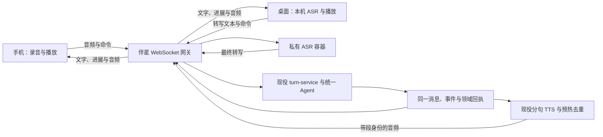

# 55 · 手机交流重设计与两端共用的伴星实时接口

**2026-10-24～25 用户最新决定与实现：** iOS 停用伴星 WebSocket，改用桌面同一套 durable SSE `/companion/conversations/:id/events`，通过 seq / `Last-Event-ID` 续接；提交、取消等命令走原有幂等 HTTP。Android 本轮保持 WebSocket。iOS 语音交互改为整个输入条内的连续通话状态和波形，VAD 停顿后自动发送，支持抢占旧回复与阻止迟到音频，离开所属页面或进入后台结束；内部仍是 MiMo 整段 ASR → Agent → 增量 TTS，不是流式 ASR 或直接音频到音频模型。回复使用气泡，同一回合包含过程与正文，失败且没有正文／成果的空记录过滤。用户要求先用本地 Docker 联调且不启动向量模型，实际结果及硬件未验证项见 [2026-10-25 联调记录](../../testing/ios-sse-local-2026-10-25.md)。下方 WebSocket 与手动转写描述保留为早期方案，不能代替本段的当前状态。

**2026-10-24 approved audit decision:** Workspace owners may explicitly restore an exact saved note version on mobile. This operation switches the current-version pointer; it preserves all saved versions and does not create another version. The endpoint retains owner authorization and optional `baseVersionId` conflict protection. Members remain read-only for restoration, and ordinary mobile freeform body edits / collaboration updates remain forbidden. This supersedes the earlier blanket restriction only for saved-version restore.

**2026-10-23 多图修订：**用户要求图片保持小缩略图、独立于文字气泡，并在覆盖全屏的浮层中浏览本次发送的整组图片。回合合同同步改为「可选首块文字＋最多 9 张图片＋最多一份文件」，取代 2026-10-15 的单附件上限；语音转写仍为唯一文字块。iOS 的系统相册使用有序多选，草稿可逐张预览／移除，发送时逐张上传，失败重试复用已有回执，完整上传后只提交一次用户消息。worker 保留全部九张的资产引用，不再截掉第三张之后的图片；图片归属与文件读取权限仍逐项校验。Android 此轮不重做入口。具体实测见 [记录与卡片验收](../../testing/ios-companion-records-2026-10-23.md)。

**2026-10-22 iOS 新决定与实施：**用户选择大伴星＋当前句气泡的「贴近说话」，长讲解自然分句完整朗读并可打断。iOS 已接 `voice.segment.ready` V2、真实 `/voice/tts/stream` 增量播放、大小形态的语义表情与电平口型、同一 Agent 的选段写入与回应。原生日志确认音频在响应体收齐前开始播放；完整范围和剩余真机验收见 [实施记录](../../testing/ios-companion-delivery-2026-10-22.md)。这条决定覆盖下文 iOS「不做流式 TTS」与「离开对话页停止声音」的旧范围；Android 与 MiMo 整段 ASR 保持原样。

**2026-10-18 原生接入状态更正：**当前双端客户端已将服务端 MiMo 整段 ASR、`POST /voice/tts` 分段朗读、图片／文件附件、Live2D manifest 下载与本地缓存，以及伴星 WebSocket 订阅接入真实页面；朗读支持暂停／继续／停止，进入后台会停止录音与播放。手机端仍不做流式 ASR，也不把服务端 TTS 分段调用描述成流式播放。具体客户端链路与剩余运行验收见 [手机端 README](../../../apps/mobile-client/README.md) 和[多轮审查记录](../../../apps/mobile-client/MOBILE_AUDIT.md)。

**2026-10-14 原生双端决定：**用户明确取代手机 React 客户端，使用 iOS SwiftUI 与 Android Kotlin/Jetpack Compose 两套原生工程，iOS 视觉与动效作为 Android 的共同标尺。用户之后明确采用 Apple 系统中性色与单一系统蓝，移除多色装饰渐变，并适配深浅色外观。共享 `/companion/inbox/ensure`、`/companion/realtime`、`/voice/transcribe` 和消息合同；图片上传仍由用户发送动作触发。两端已有登录、WebSocket 会话／回执、MiMo 整段转写和手记读取代码。React 描述是 2026-10-12 历史实现状态；桌面仍使用 SSE 与本机 ASR，移动端也没有流式 ASR/TTS。当前工程和未迁移能力见 [`apps/mobile-client/README.md`](../../../apps/mobile-client/README.md) 与 [界面规范](../../../apps/mobile-client/DESIGN_SPEC.md)。

**2026-10-15 修订：**①回合消息合同扩展：turn 输入放宽为「文字＋至多一个附件（图片或文件）」或「仅附件」；新增 file 块，携带客户端本机抽取的 text 摘要与 assetId／name／mime／size；无文字时登记显式「仅附件意图」，不伪造文案。仍按方案 55 既有规则：新增消息类型与合同变更集中在 `packages/shared` 合同并由客户端与 API 共用校验，zod 测试同步更新。②移动端接入 TTS：复用已有 `POST /voice/tts`（返回 audio/mpeg）与 `POST /voice/tts/stream`，承载粒子波动与口型，受 AI 同意＋部署开关双门控（`COMPANION_VOICE_DIALOGUE_V1_ENABLED`／`COMPANION_STREAMING_VOICE_V1_ENABLED` 生产默认关闭，移动端完整语音体验需开启）。③Live2D 模型分发：新增鉴权接口下发版本清单与对象存储临时签名下载 URL（复用 `signObjectDownload` 基建），模型运行时下载、不随安装包分发，加载失败降级静态图。④「流式 ASR 不做」不变，本修订只补 TTS 播放链路，不改变 ASR 仍为 MiMo 整段上传的事实。

日期：2026-10-12。用户要求重新检查已开始实施的手机端，并提出手机语音在服务端执行、伴星改用 WebSocket、桌面共用接口而继续本机 ASR；后续明确手机 ASR 使用小米 MiMo。

首轮分析记录：真实手机交流页的构图调整、独立语音状态示意、接口与迁移建议。以下是后续实现状态（2026-10-12）：手机已有鉴权伴星 WebSocket，负责订阅持久事件和提交文字回合；麦克风录音通过现有 `/voice/transcribe` 上传服务端，由小米 MiMo `mimo-v2.5-asr` 做整段识别，结果回填可编辑草稿。服务端语音开关默认关闭，且需要用户语音识别同意与 MiMo 配置。当前没有流式 ASR、WS 二进制音频、移动端 TTS/播放或桌面 WebSocket 迁移；ASR 容器建议已由用户选择小米 MiMo 的决定取代。

后续手机实屏审计中，本机 `/health` 返回 HTTP 200；登录态页面读取了共享会话历史，WebSocket 客户端未显示重连提示，符合已收到 `subscribed` 的状态。没有发送新回合，因此 `turn.submit` 与事件回流尚未在本轮实屏验证；也没有请求麦克风或调用 MiMo 上游。其余代码级、类型、构建和离线测试证据见[窗口记录](../../testing/mobile-realtime-redesign-2026-10-12.md)。

**手机图片输入后续补充（2026-10-12）：** 真实 React 客户端现已接通照片／相册选择、鉴权上传、同回合文字提问、历史消息图片和私有图片鉴权读取；其状态与验证证据记录在[手机图片输入记录](../../testing/mobile-image-intake-2026-10-12.md)。这项 HTTP 图片能力不改变本文的 WS／ASR／TTS 状态：语音示意依旧不是生产语音链路。

## 1. 改造前基线与当前状态

下表保留首轮改造前的调用链判断，用于说明改动原因；当前实现进展以文首状态和第 7 节为准。

建议采用用户提出的方向：**一个伴星 WebSocket 入口，手机上传音频由服务端转写，桌面只上传本机转写文本，Agent 和 TTS 共用。** 统一的是实时会话协议、状态机与服务端业务，并不要求两端的采集、解码、播放实现完全相同。

| 真实链路 | 2026-10-12 核对结果 | 本轮处理或建议 |
| --- | --- | --- |
| 手机工程 | `apps/mobile-client/src` 是独立 React/Vite 工程，已经调用身份、伴星、笔记 API；与 `prototype/` 不同，仍是浏览器客户端，尚无原生安装包 | 修正“只有原型”的入口描述；浏览器不能证明原生录音、音频中断或发布能力 |
| 手机构图 | `ConversationScreen` 把角色、所有记录和输入固定同时摆放；角色高度是 37vh，输入再次预留导航高度 | 默认见伴星；顶部切换完整记录，两种视图共用状态与草稿；取消重复的底部留白 |
| 手机语音 | 改造前 README 未接输入与朗读；`state/companion.ts` 忽略 voice 事件 | 已接 MiMo 整段 ASR 和可编辑转写；声音播放仍待实现 |
| 对话发送与接收 | 改造前手机 POST turns + fetch SSE；桌面经主进程订阅 SSE，另行取 TTS | 手机已用 WebSocket 订阅事件和提交回合；桌面仍走 SSE；取消与提案确认继续用 HTTP |
| TTS | 服务端已有 Qwen/Edge 引擎、按语音段合成、预热与去重 | 沿原引擎和语气合同接音频输出，避免另建第二个朗读服务 |
| ASR | 手机通过 `/voice/transcribe` 整段上传到小米 MiMo；桌面实际走本机识别 | 使用现有服务端 MiMo 适配器；没有部署 ASR 容器，桌面维持本机识别 |
| WebSocket 底座 | `/note-doc` 已用 `@fastify/websocket` | 复用插件基础；伴星与协同文档仍有各自领域合同 |
| 恢复与权限 | 已有事件 seq、generation、幂等回合、workspaceEpoch、提案确认和正式作答围栏 | 全部沿用；换传输不能丢掉这些语义 |

主要代码依据：

- `apps/mobile-client/src/conversation/ConversationScreen.tsx`、`styles/conversation.css`、`styles/companion.css`。
- `apps/mobile-client/src/platform/companion-realtime.ts`、`state/companion.ts`。
- `apps/api/src/modules/companion-conversation/turn/turn-service.ts`、`turn/companion-events.ts`。
- `apps/api/src/modules/learning-sessions/voice-routes.ts`、`companion-voice-service.ts`、`companion-tts-warm.ts`、`voice-providers/tts-engine.ts`。
- `apps/desktop-client/src/renderer/src/components/companion/local-speech-recognition.ts`、`src/main/desktop-gateway-ns-companion.ts`。
- `packages/shared/src/contracts/companion-conversation-contracts.ts`、`companion-voice-contracts.ts`。

## 2. 手机交流的空间

**见面时完整见她，翻记录时完整读正文，开口时围绕当前一句。** 用同一屏的形态变化承担情境，不再在小屏上固定分割一大块角色和一小块聊天。

### 2.1 伴星视图

顶部只保留当前书房与“伴星／记录”切换。角色在中间完整呈现轮廓；下方纸面放当前话语，长回复有“展开记录”。预览只收起显示，原始消息没有截短或重新生成。待确认动作留下可点击的提醒，进入记录查看真实提案与对照。

底部输入跟随可见视口。文字键盘弹起时收起底部导航、缩短当前话语预览，焦点和发送立即生效。中文输入法正在选字时，回车不能提交。

### 2.2 记录视图

正文取得整块中间空间，取消固定 37vh 舞台。模型节点保留，隐藏时暂停渲染；切回角色不重新下载或创建模型。人物对白以连续纸面阅读，用户问题保留较轻的气泡，工具进展、待确认和真实笔记回执继续显示。

查阅的材料独立展开，不拼进伴星对白；正文复用共享 Markdown 解析，标题、列表、表格和代码按真实内容阅读。切换视图不另开会话、不清草稿、不停止业务任务。首轮 UI 窗口验收时手机仍沿用 SSE；后续已切到移动端 WebSocket，见第 7 节。

### 2.3 语音形态

普通输入旁一枚麦克风开启语音交流，首次点击才请求麦克风并解锁播放。角色、当下短句、输入转写和声音状态成为主画面，完整内容继续在同一记录中。这是完整语音体验的方向；当前实现仅支持用户点按录音、停止后整段 MiMo 识别、可编辑转写再发送，没有 partial 和声音播放。下表描述目标状态；当前 UI 只有录音中、取消、完成、识别中和可编辑转写这些步骤。

| 状态 | 画面与操作 | 业务含义 |
| --- | --- | --- |
| 等待开口 | 角色安静待机，文字输入可用 | 没有录音，也没有自动开麦 |
| 正在听 | 转写草稿、输入音量、说好了／用文字／结束 | 手机音频上传 ASR；草稿尚未创建回合 |
| 整理这句话 | 转写定稿状态，允许撤销未提交话语 | 等 ASR final；不能在 partial 时执行写工具 |
| 回复与操作 | 小气泡显示当前内容，真实工具标签在旁 | Agent 运行与播放是两个状态；文字不等声音 |
| 实际朗读 | 当前音频段、对应短句、暂停／我想说／结束 | 口型来自实际播放 PCM 或可靠幅度包络 |
| 暂停 | 停住声音与口型，保留位置，继续／我想说 | 不等于取消 Agent 任务 |
| 我想说 | 本机立即停旧声音并清队列，再开启新话语 | 同时发送取消／抢占；迟到旧段不能重开播放 |
| 结束语音 | 回文字输入，未提交转写丢弃，文字草稿保留 | 已接受的业务任务可继续完成，后续只收文字与回执 |
| 网络／录音／合成失败 | 在当前话语旁说明可执行下一步 | 保留真实文字；不给假波形、假口型或自动外发 |

首版采用显式“说好了”的可打断轮流交流。录音期间不播放伴星，减少扬声器回声误提交。自动端点与连续多轮可沿同协议增加；同时说话、自动声学打断需要 AEC、VAD 和真机证据，不能由 WebSocket 推出已经支持全双工通话。

示意入口：开发服务器的 `/demos/companion-realtime.html`。它使用已有本机 Live2D 资源；所有转写、回复和语音状态均标为样例，不申请麦克风、不调用 ASR/Agent/TTS、不播放浏览器朗读。只用于检查构图、切换、暂停与打断。

## 3. 一个实时入口的职责（目标架构）

以下图与本节是原始全双工目标，不是当前已落地链路。现状是：手机先通过 HTTP 把整段 WAV 发给小米 MiMo，用户检查／编辑转写后通过 WebSocket 提交文字回合；桌面仍走 SSE 与本机 ASR。

推荐 `GET /companion/realtime` 为 WS 入口。客户端只连接 API，不直接连接 ASR/TTS 容器。登录、历史分页、笔记查询、图片和大文件上传继续用已有 HTTP；“一个接口”指实时交流通道，不把所有 CRUD 和大文件塞进声道。

ASR 容器只负责识别，TTS 只负责声音，网关只负责连接、路由和播放投递。人格、记忆、工具、确认、保存与任务运行仍由现役 Agent/领域服务负责。

## 4. 扩展协议蓝图

首轮协议表是实施蓝图，其中录音流、回放租约等尚未实现。文字与事件子集已经在 shared realtime 合同和 API／手机端连接器中落地：首帧 `auth`、`auth.ok`、`subscribe`／`subscribed`、持久 `event`、`turn.submit` 与关联结果；取消、提案、图片仍走既有 HTTP。后续新增消息类型仍需集中在 shared 合同并由客户端与 API 共用校验。

### 4.1 绑定与能力协商

连接后的第一条 JSON 为 `session.bind`，带 protocolVersion、当前会话凭据、conversationId、workspaceEpoch、afterSeq、clientInstanceId 和设备能力。浏览器原生 WebSocket 不能像现有 fetch SSE 那样设置 Authorization header，两端统一按首帧绑定。凭据不放 URL，日志不记录绑定载荷。

服务端校验来源与真实 session、空间成员、会话归属、账号声音设置和正式作答状态后才发送任何业务数据。未鉴权连接设短超时与字节/连接上限；鉴权前仅允许绑定帧。长连接仍需处理会话过期、撤销、空间权限变化，不能只在握手检查一次。

回包 `session.ready` 包含实际支持的 `serverAsr`、`tts`、输入格式和输出格式；ASR 未配置时明确不可用，手机文字仍可用。客户端自报 `localAsr` 只说明输入方式，不会扩大权限。

### 4.2 JSON 命令与事件

| 方向 | 类型 | 说明 |
| --- | --- | --- |
| 上行 | `turn.submit` | 桌面本机转写、普通文字；复用 clientMessageId 幂等与 supersedesGeneration |
| 上行 | `input.start` | 创建手机 utteranceId，声明采样率/编码；不立即执行 Agent |
| 上行 | `input.commit` | 结束本次采集，要求 ASR 最终定稿并提交；携带稳定 clientMessageId |
| 上行 | `input.abort` | 丢弃未提交话语，取消 ASR、释放缓冲 |
| 上行 | `turn.cancel` | 复用现役 runId/generation 取消；本机声音无需等 ack 才停止 |
| 上行 | `proposal.decide` | 仍带现役 proposalId、payloadSha256 和精确决定；不绕过审批 |
| 上行 | `playback.claim/release` | 领取／释放这轮音频播放权，服务端检查租约；重连不自动抢回 |
| 上行 | `playback.state` | started/paused/completed/failed、实际段与播放位置，接现有播放结果记录 |
| 双向 | `ping/pong` | 应用心跳、判断失联；不能用它推断录音或播放正在发生 |
| 下行 | `command.ack` | accepted/rejected/completed；包含 requestId 和可恢复结果 |
| 下行 | `asr.partial/final` | 同一 utteranceId 的覆盖式转写，revision 单调增加；只有 final 可入回合 |
| 下行 | `conversation.event` | 封装现有 CompanionStreamEventV1，包括 turn/text/tool/proposal/character cue |
| 下行 | `audio.segment` | segmentId、runId、generation、textRange、ordinal、codec、表达与传输元数据 |
| 下行 | `audio.end/error` | 完成或失败；TTS 失败不抹掉文本与业务结果 |
| 下行 | `sync.required` | 事件游标已过期，要求重读真实快照；不猜中间发生了什么 |

控制消息带 requestId；涉及创建的命令用稳定业务幂等键。消息的 conversation seq、事件 seq、音频 chunkIndex、ASR revision 各有自己的序列，不能混用。持久事件沿用服务端 conversation 事件游标；ASR 草稿、心跳和音频字节不写入事件表。

手机的 `input.commit` 由服务端等待 final、创建并绑定现有 voice artifact、直接调用现有 create-turn 业务。final 同时返回手机用于显示，**手机无需把同一份转写再提交一次**。`utteranceId + clientMessageId` 去重，ack 丢失时查询／重放同一命令结果；断线时没有定稿的录音不自动重新上传。

桌面继续本机识别，只发送文本。现行桌面本机转写作为 text 进入回合，服务端 voice_transcript 反而要求已存在的 voiceArtifactId；迁移时保留这一事实，不能编造远端 provenance。若需要统一显示来源，再加可校验的 inputOrigin 元数据，把“本机转写来源”与“服务端 artifact”明确区分。

### 4.3 音频二进制

音频使用 binary frame，不在每帧 JSON 中塞 base64。输入首版建议协商单声道 PCM16/16kHz，以约 40–80ms 小块发送；客户端只保留有界暂存，API 只内存转发，不把用户输入音频写数据库、对象存储或日志。

每个二进制帧使用固定头：版本、方向、streamId、chunkIndex 与有效负载长度；streamId 在 JSON 控制消息中绑定 utteranceId 或 segmentId。接收方按身份与长度检查，旧 generation 的段即使晚到也丢弃。

输出需要明确播放能力：

- 第一批可沿现役 TTS 合成**完整短句 MP3**，每句音频收齐再解码播放，下一句并行准备；不等待整篇回复。这能复用现有声音缓存与语气系统。
- 后续如要降低首音频延迟，再协商可连续解码的 PCM 输出与 AudioWorklet/native 播放器，或验证宿主的连续压缩流解码。不能把任意 MP3 网络分片逐片当独立音频交给 `decodeAudioData`。
- 语义 cue 与口型分别处理：cue 取实际播放段的模型表达；嘴部强度取播放器音量，文字 delta 到达不张嘴。

控制与语音共用连接时，发送队列要限制未播放音频的时长与总字节；最多有限段预取，控制帧先调度，不能把整段长音频排进底层缓冲后指望取消帧越过它。持续超限停止本轮音频、保留文字，并给出可重试状态。浏览器 WebSocket 没有自动背压，须监测 bufferedAmount 并用播放消费回执限制下行供给。

## 5. ASR 容器与引擎候选（原建议，已被 MiMo 决定取代）

本节保留用户选定服务端 ASR 前的候选分析，不能当作当前待办：用户已明确要求手机使用小米 MiMo，当前代码接现有 MiMo 整段识别适配器，暂不部署 ASR 容器。

手机不携带识别模型与推理引擎，服务器常驻加载模型，容器通过私有网络提供识别服务。客户端仍要携带录音、音频处理、播放和角色渲染代码，安装包缩减不等于这些功能消失。现役桌面模型本来就是用户额外下载、未放进安装包；桌面继续该策略。

推荐先验证 **FunASR online/2pass** 容器：online 给出临时转写，离线校正给 final；这与“边说边显示，提交时以定稿执行”匹配。[官方在线部署说明](https://github.com/modelscope/FunASR/blob/main/runtime/docs/SDK_advanced_guide_online.md)给出了容器与在线模型路径，具体镜像 digest、模型版本、许可与资源占用在落地时固定和实测。

如果采用 SenseVoice 容器，可以先做 VAD 分段后的快速整段识别，方便沿用已有模型经验；但现有 sherpa-onnx SenseVoice 官方 WebSocket 示例运行的是 **non-streaming server**，改成 WS 不会让识别模型本身变成流式。[官方 SenseVoice 示例](https://k2-fsa.github.io/sherpa/onnx/sense-voice/python-api.html)。这是引擎路径的区别，不应把重复识别累计音频包装成已经验证的真流式。

容器内常驻权重、并发/排队上限、取消请求、空白结果、实际音频时长与超限拒绝属于 ASR 适配器职责；业务配额、模型外发同意、空间权限与 provenance 继续在 API。自建 ASR 走专用内部适配器，不能简单把 SiliconFlow 地址换成内网地址并继承它的公网请求合同。

首批先实测中文学习词、术语、停顿、噪声和低配置服务器，再固定引擎。TTS 继续现役配置，是否外发跟部署和 provider 实际行为走，不因为部署了 ASR 容器就声称全部语音都在自有服务器推理。

## 6. 低延迟、恢复和跨端声音

完整语音形态未来可以减少拆开的业务往返，并统一双向命令、音频与事件；WebSocket 不会自动让 ASR、LLM 或 TTS 更快。下列流式采集与音频投递是后续目标，当前 MiMo 仍采用整段 HTTP 上传：

1. 手机采集的同时上传，不等整段录音再开始网络发送。
2. 服务端取得 final 就在内部提交，省掉 final→手机→POST turns。
3. 沿现役语气分段尽早合成第一句，后续文字和工具事件持续可读。
4. 本机打断先停声与队列，再等服务端取消 ack；AbortSignal 贯通 ASR/合成/代理，旧 generation 不能复活。
5. ASR、模型与声音队列都常驻且有界；弱网不积累数十秒过时音频。

同一会话多设备都可收到文字与进展，**音频只投递给持有播放租约的设备**。用户在手机主动开始语音／桌面明确播放才领取；另一端只更新文字，避免两台设备一起读。租约跟 session、clientInstanceId 和 connection epoch 绑定，有失联到期与显式移交规则。

连接断开不取消已经接受的 Agent 业务。重连从最后消费的事件 seq 补文字/状态，过期则先快照后续流。不要重放旧麦克风数据、自动接着读旧音频或自动开麦；用户主动恢复播放时才按仍有效的段请求继续。原声历史是否跨端保存仍按 51 的边界另行决定，本轮不偷偷增加音频持久化。

进入后台停止录音和播放、释放声道；回前台恢复数据，不自动开麦／播放。耳机拔出、来电、系统夺走音频焦点需要原生宿主验证。浏览器 preview 不提供这些证明。

## 7. 迁移顺序与代码边界

| 步骤 | 实际改动 | 判据 |
| --- | --- | --- |
| 1：手机构图 | 本轮已调整真实交流页，另有语音示意 | 长记录可读、输入可达、切换不丢草稿、无声不张嘴 |
| 2：协议与网关 | 已有 shared realtime 合同、API `/companion/realtime`、手机鉴权／订阅／事件恢复／`turn.submit`；取消、提案和图片仍用 HTTP，断线回退复用幂等 ID | 复用 turn-service/现有事件；已测未认证连接被拒，登录态链路需在健康 API 环境验收 |
| 3：手机语音 | 已接浏览器录音、16 kHz 单声道 WAV、`/voice/transcribe` → 小米 MiMo 整段识别、可编辑转写；没有 ASR 容器、实时 partial、WS 音频或 TTS 播放 | 需真机麦克风、已启用服务端语音开关与真实 MiMo 配置做端到端验收 |
| 4：桌面接入 | 主进程连接同一网关，preload 保留 IPC，renderer 保留本机 ASR 与播放器 | 桌面录音不上网；手机/桌面同业务与协议；renderer 不接触凭据 |
| 5：清理旧链 | 手机未使用的 SSE 客户端包装已删除；桌面仍有 SSE 消费者，待桌面 WS 迁移后再清理；按句 HTTP 拉音频也待音频通道上线后删除 | 先核对所有运行时消费者，其他后台 SSE 不跟着删除；不长期维护两套伴星后端 |

`@fastify/websocket` 已提升到共同注册点，伴星与 `/note-doc` 共用插件基础且保留各自鉴权/readOnly。手机 Vite 代理已启用 WS，CSP 按配置的 API origin 推导对应受限 ws/wss origin；桌面 CSP 和连接出口仍在主进程核对。

建议新模块按职责分为 API 连接/会话绑定、命令分发、事件订阅、ASR 会话、音频投递/播放租约；共享包承载协议与纯状态逻辑，手机和桌面分别承载设备音频适配器。网关不引入第二个 Agent 执行循环，也不复制现有提案与写入处理。

## 8. 验证与指标

**首轮 UI 验证范围及限制见[窗口记录](../../testing/mobile-realtime-redesign-2026-10-12.md)。** 手机 WS / MiMo 接线后的代码验证和未完成的线上验收也记录在该文件。尚需完成：

- 手机中文短句、长停顿、没有声音、撤销未提交转写、断线未定稿、权限拒绝。
- 发送成功但 ack 丢失、相同 clientMessageId 重试、事件游标过期、账号／空间切换后的迟到帧。
- 持续说话时数次我想说／暂停／继续／结束，旧音频、表情与文字不能串入新轮。
- 手机与桌面同时打开同会话，只有主动持有声道的设备播放；文字、操作与保存仍同步可读。
- TTS 失败/排队超时/背压时文字与回执正常；播放器终态进入现役观测。
- 桌面本机 ASR 缺模型与识别失败不发音频；手机没有模型下载入口。
- 真机键盘、150% 字体、320/390/430 宽度、系统减少动态、来电和耳机拔出。

分阶段记录 p50/p95：采集到首 partial、停止说话到 final、final 到 turn.accepted、accepted 到首字、首句就绪到首次实际播放、本机打断到停声、旧 generation 丢弃计数、队列时长/字节高水位。服务器与客户端时钟不直接相减，使用各自单调时钟和关联 trace。未取得当前 HTTP/SSE 与新链路的同输入基线前，不承诺固定毫秒收益。

## 9. 外部技术依据

- [MDN WebSocket](https://developer.mozilla.org/en-US/docs/Web/API/WebSocket)：双向 API、binaryType/bufferedAmount，以及缺少自动背压。
- [Fastify WebSocket 官方插件](https://github.com/fastify/fastify-websocket)：注册顺序、请求 hook 与升级后的消息处理边界；消息监听需同步挂好再开始异步工作。
- [FunASR online 部署](https://github.com/modelscope/FunASR/blob/main/runtime/docs/SDK_advanced_guide_online.md)：容器化 online/2pass 识别候选。
- [sherpa-onnx SenseVoice](https://k2-fsa.github.io/sherpa/onnx/sense-voice/python-api.html)：官方 non-streaming WS 示例，不把传输流式等同于模型流式。
